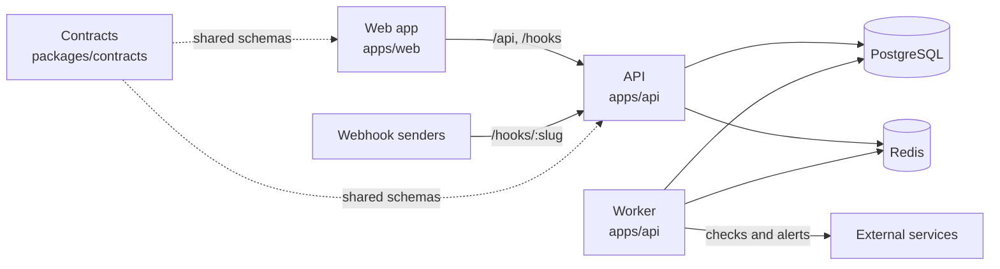

# Pulse

Pulse monitors HTTP endpoints and incoming webhooks for small teams. It checks your APIs on a schedule, records every
webhook it receives, opens an incident when something breaks, alerts the team, and resolves the incident when the
problem clears.

## Features

- **HTTP monitors.** Check any URL every 30 seconds to 1 day. Each check records status code, response time and
  outcome (up, degraded or down). Uptime is calculated over the last 24 hours.
- **Webhook endpoints.** Each endpoint gets an unguessable ingest URL. Pulse stores each request (with credentials
  redacted) and marks the endpoint silent if no event arrives within a configured window.
- **Incidents.** Opened after a configurable number of consecutive failed checks, or when a webhook goes silent.
  Outages are critical and page the team; slow responses open a warning without paging. Incidents resolve
  automatically on recovery, and the team can acknowledge and resolve them, with a record of who did what.
- **Alerts.** Email, Slack and signed webhook channels, with retries, a delivery log and a test button that reports
  the real result.
- **Live updates.** Dashboards, lists and badges update on their own as checks run and incidents change.
- **Team access.** One invite-only workspace with four roles (owner, admin, member, viewer), verified email addresses,
  and sign-in with a password, GitHub or Google.

## Architecture



| Part                 | Technology                                                               |
| -------------------- | ------------------------------------------------------------------------ |
| Web app              | React 19, TanStack Router, Query and Form, Tailwind CSS 4, Radix UI       |
| API                  | Node 26, Express 5, Drizzle ORM                                           |
| Worker               | BullMQ (runs HTTP checks, silence detection, alert delivery, cleanup)    |
| Live updates         | Server-Sent Events, fanned out across processes with Redis pub/sub        |
| Email                | SMTP via nodemailer; Mailpit catches mail in local development           |
| Data                 | PostgreSQL 18, Redis 8                                                    |
| Shared contracts     | zod schemas used by both the web app and the API                         |
| Tooling              | pnpm workspaces, Turborepo, TypeScript, Vitest, oxlint, Prettier          |

The API and the worker are two processes built from the same code. The API answers requests and puts slow work on
Redis queues; the worker picks it up. Node runs the TypeScript directly, so the backend has no build step.

## Repository layout

```
pulse/
├── apps/
│   ├── api/              backend: API server, background worker, database models and migrations
│   └── web/              frontend: React single-page app
├── packages/
│   ├── contracts/        request and response schemas, endpoint list, roles and permissions
│   └── ui/               shared UI components
├── docs/
│   ├── backend-guide.md  how the backend code works and how to extend it
│   ├── system-design.md  requirements, architecture, data model and flow diagrams
│   └── audit.md          security and production-readiness audit, with status
├── e2e/                  Playwright end-to-end suite (backend and browser)
└── docker-compose.yml    PostgreSQL, Redis and Mailpit for local development
```

## Getting started

### Prerequisites

- Node.js 26 or later
- pnpm 12 (`corepack enable` installs the version pinned in `package.json`)
- Docker, for PostgreSQL and Redis

### Install and run

1. Install dependencies:

   ```bash
   pnpm install
   ```

2. Start PostgreSQL, Redis and Mailpit:

   ```bash
   docker compose up -d
   ```

3. Create the backend environment file and set the two secrets:

   ```bash
   cp apps/api/.env.example apps/api/.env
   openssl rand -base64 48   # run twice; paste into JWT_SECRET and INVITE_SECRET
   ```

4. Create the database tables and load demo data:

   ```bash
   pnpm --filter api db:migrate
   pnpm --filter api db:seed
   ```

5. Start the API and the web app in one terminal, and the worker in another:

   ```bash
   pnpm dev                     # API on :3000, web app on :5173
   pnpm --filter api worker     # background jobs
   ```

6. Open http://localhost:5173 and sign in as `owner@pulse.dev` with password `password123`.

The seed also creates `admin@pulse.dev`, `member@pulse.dev` and `viewer@pulse.dev` with the same password, so you can
see what each role is allowed to do.

Pulse is invite-only: after the first owner exists, people join only through an invitation from an owner or admin.
Emails (invitations, verification, password resets, email alerts) are caught by Mailpit; read them at
http://localhost:8025.

### Verify the setup

```bash
curl http://localhost:3000/api/health
# {"status":"ok","database":"ok","redis":"ok","worker":"up","workerLastSeenAt":"..."}
```

`/api/health` reports `503` with `"status":"degraded"` when the database, Redis or the worker is not healthy.

New monitors change from `pending` to `up` or `down` within about 15 seconds of creation. If they stay `pending`, the
worker is not running.

To send a test event to a webhook endpoint, copy its ingest URL from the Webhooks page:

```bash
curl -X POST http://localhost:5173/hooks/stripe-events \
  -H "Content-Type: application/json" \
  -d '{"type":"invoice.paid","amount":1200}'
```

The event appears on the endpoint's detail page.

## Configuration

### Backend (`apps/api/.env`)

`apps/api/.env.example` lists every variable with a working local value. The API validates them at startup and exits
with a message naming any variable that is missing or invalid.

**Core**

| Variable | Required | Description |
| -------- | -------- | ----------- |
| `NODE_ENV` | Yes | `development`, `test` or `production`. There is no default, so production safety never depends on a guess |
| `PORT` | No | API port. Default `3000` |
| `LOG_LEVEL` | No | `fatal`, `error`, `warn`, `info` (default), `debug`, `trace` or `silent` |
| `APP_URL` | Yes | Public URL of the web app. Used to build invite, reset, verification, ingest and OAuth links |
| `APP_VERSION` | No | Reported by the worker heartbeat. Default `dev` |
| `DATABASE_URL` | Yes | PostgreSQL connection string |
| `REDIS_URL` | Yes | Redis connection string |
| `JWT_SECRET`, `INVITE_SECRET` | Yes | At least 32 characters each. Production rejects the example placeholders |
| `TRUST_PROXY` | No | Which proxies may set the client IP: `false`, a hop count, or IPs, CIDRs and `loopback`, `linklocal`, `uniquelocal`. Default `loopback`. Set it to match your load balancer |
| `COOKIE_SECURE` | No | Overrides the `Secure` cookie flag. On by default outside development; `false` is rejected in production |

**Accounts and email**

| Variable | Required | Description |
| -------- | -------- | ----------- |
| `OWNER_SIGNUP_ENABLED` | No | Allows the very first account to be created through sign-up. Default `false`; `true` in `.env.example` for local setup. In production, create the owner with `pnpm --filter api user:create-owner` instead |
| `MAIL_TRANSPORT` | No | `smtp` (default) or `file`. Production requires `smtp` |
| `MAIL_FILE` | With `file` | Where the file transport writes messages (used by tests) |
| `MAIL_FROM` | In production | Sender address, e.g. `Pulse <alerts@example.com>` |
| `SMTP_HOST`, `SMTP_PORT`, `SMTP_SECURE`, `SMTP_USER`, `SMTP_PASSWORD` | `SMTP_HOST` in production | SMTP server. Locally Mailpit on `localhost:1025` |
| `GITHUB_CLIENT_ID`, `GITHUB_CLIENT_SECRET` | No | Enables "Continue with GitHub" |
| `GOOGLE_CLIENT_ID`, `GOOGLE_CLIENT_SECRET` | No | Enables "Continue with Google" |

**Monitoring, webhooks and limits**

| Variable | Default | Description |
| -------- | ------- | ----------- |
| `ALLOW_PRIVATE_NETWORK_TARGETS` | `false` | Lets checks and alerts call private and loopback addresses. `true` in `.env.example` for local development. Never enable in production |
| `MAX_MONITORS_PER_WORKSPACE` | `100` | Monitor limit |
| `CHECK_WORKER_CONCURRENCY` | `20` | Checks run at once per worker process |
| `CHECK_MAX_CONCURRENCY_PER_HOST` | `4` | Checks in flight per target host, across all workers |
| `CHECK_DISPATCH_INTERVAL_MS` | `15000` | How often the worker looks for due checks |
| `SILENCE_CHECK_INTERVAL_MS` | `60000` | How often the worker looks for silent webhooks |
| `WEBHOOK_MAX_BODY_BYTES` | `262144` | Largest accepted webhook body |
| `WEBHOOK_INGEST_PER_SLUG_PER_MINUTE` | `120` | Ingest rate limit per endpoint |
| `WEBHOOK_INGEST_PER_IP_PER_MINUTE` | `600` | Ingest rate limit per sender IP |
| `WEBHOOK_EVENT_RETENTION_DAYS` | `30` | Events older than this are deleted daily |
| `WEBHOOK_MAX_EVENTS_PER_ENDPOINT` | `1000` | Most recent events kept per endpoint |
| `API_RATE_LIMIT_PER_MINUTE` | `300` | Requests per minute per IP across the API |

**Live updates and operations**

| Variable | Default | Description |
| -------- | ------- | ----------- |
| `LIVE_HEARTBEAT_INTERVAL_MS` | `25000` | Keep-alive interval on the live updates stream |
| `LIVE_MAX_CONNECTIONS_PER_USER` | `5` | Open live streams per user, per API process |
| `METRICS_TOKEN` | unset | Bearer token for `GET /metrics` (Prometheus). The endpoint is disabled when unset |

### Frontend (`apps/web/.env.development`)

| Variable           | Description                                                                         |
| ------------------ | ----------------------------------------------------------------------------------- |
| `VITE_API_URL`     | Base path for API calls. Default `/api`                                             |
| `VITE_API_MOCKING` | `false` uses the real API. `true` uses a mock API that runs in the browser, with no backend |
| `API_PROXY_TARGET` | Where the Vite dev server forwards `/api` and `/hooks`. Default `http://localhost:3000` |

### OAuth

GitHub and Google sign-in are optional. To enable one, register an OAuth app with the provider, set its callback URL to
`http://localhost:5173/oauth/callback/github` or `http://localhost:5173/oauth/callback/google`, and add the client ID
and secret to `apps/api/.env`. Buttons appear only for configured providers. OAuth signs in existing members; it never
creates accounts in an invite-only workspace, and it links to an existing account by email only when that email is
verified.

## Scripts

Run from the repository root:

| Command            | Description                                         |
| ------------------ | --------------------------------------------------- |
| `pnpm dev`         | Starts the API and the web app in watch mode        |
| `pnpm build`       | Builds the web app for production                   |
| `pnpm test`        | Runs the backend unit and integration tests         |
| `pnpm test:e2e`    | Runs the end-to-end suite (backend and browser)     |
| `pnpm typescript`  | Type-checks every package                           |
| `pnpm lint`        | Lints the repository with oxlint                    |

Backend-specific, run with `pnpm --filter api <script>`:

| Script        | Description                                                         |
| ------------- | ------------------------------------------------------------------- |
| `dev`         | API server in watch mode                                            |
| `worker`      | Background worker in watch mode                                     |
| `start`       | API server without watch mode                                       |
| `test`        | Integration and unit tests                                          |
| `db:generate` | Creates a migration from changes in `src/models`                    |
| `db:migrate`  | Applies pending migrations                                          |
| `db:seed`     | Replaces all data with demo data. Refuses to run in production      |
| `db:studio`   | Opens Drizzle Studio to browse the database                         |

## Testing

Pulse has two test layers. Both need PostgreSQL and Redis running (`docker compose up -d`).

### Backend unit and integration tests

```bash
pnpm test
```

Vitest runs against a separate `pulse_test` database and Redis database 1, so it never touches development data. Most
tests send real HTTP requests to an in-process API, which covers routing, authentication, permissions, validation,
database constraints and error responses together.

### End-to-end tests

```bash
pnpm --filter e2e install-browsers   # once, downloads Chromium
pnpm test:e2e
```

The Playwright suite in `e2e/` starts its own API, worker and web app on ports 3100 and 5174 against a `pulse_e2e`
database and Redis database 2, then seeds demo data. It has two projects:

| Project | Command                        | What it covers                                                                 |
| ------- | ------------------------------ | ------------------------------------------------------------------------------ |
| `api`   | `pnpm --filter e2e e2e:api`    | The running API and worker over HTTP: auth and token rotation, permissions, the check-to-incident-to-alert pipeline, webhook ingest and silence detection, invitations |
| `ui`    | `pnpm --filter e2e e2e:ui`     | Every page as each role in Chromium: sign-in, sign-up, password reset, monitors, incidents, alert channels, webhooks, team, settings |

Alert delivery is verified for real: tests point an alert channel at a Pulse webhook endpoint and assert that the
worker's alert arrives as an event. Failed tests keep a trace, screenshot and video; open them with
`pnpm --filter e2e report`.

The Postgres container creates `pulse_test` and `pulse_e2e` on first start. If your volume is older, create them once:
`docker compose exec postgres createdb -U pulse pulse_e2e`.

## API conventions

- All endpoints are under `/api`, except the public webhook ingest URL `/hooks/:slug`.
- Requests and responses use JSON. Lists accept `page` and `pageSize` and return `{ items, page, pageSize, total }`.
- Authenticated requests send `Authorization: Bearer <accessToken>`. Access tokens last 15 minutes and are renewed with
  a refresh token held in an `httpOnly` cookie.
- Errors always have the shape `{ "error": { "code", "message", "fieldErrors" } }`. Rate-limited responses (`429`)
  include a `Retry-After` header.

Every endpoint, with its access rule and request and response schemas, is defined in
`packages/contracts/src/api/endpoints.ts`.

## Documentation

- [Backend guide](docs/backend-guide.md): how the backend is organised, how a request flows through it, how errors,
  authentication, jobs, caching and rate limiting work, and how to add a feature.
- [System design](docs/system-design.md): functional and non-functional requirements, capacity estimates, high-level
  architecture, data model, live updates, and sequence diagrams for the main flows.
- [Audit](docs/audit.md): security and production-readiness findings and how each was resolved.

## Troubleshooting

| Symptom                                   | Cause and fix                                                                          |
| ----------------------------------------- | -------------------------------------------------------------------------------------- |
| "Unable to reach the server" in the web app | The API is not running or crashed at startup. Check its terminal output.             |
| Signed out after every page reload        | Open the app at `localhost:5173`, not `localhost:3000`. The refresh cookie relies on the dev proxy. |
| Monitors stay `pending`                   | Start the worker with `pnpm --filter api worker`.                                      |
| `Invalid environment variables` at startup | Compare `apps/api/.env` with `apps/api/.env.example`. An older `.env` is missing `NODE_ENV`, which is now required. |
| Local monitors fail with "Blocked: private network address" | Add `ALLOW_PRIVATE_NETWORK_TARGETS=true` to your local `.env`. |
| No invitation, reset or verification email arrives | Open Mailpit at http://localhost:8025. In production, check the SMTP settings. |
| The header shows "Reconnecting" | The live updates stream lost its connection; it retries automatically. If a proxy sits in front of the API, disable buffering and compression for `/api/events`. |
| Tests fail with `database "pulse_test" does not exist` | The Postgres volume predates the init script. Run `docker compose exec postgres createdb -U pulse pulse_test`. |

More cases are covered in the [backend guide](docs/backend-guide.md#20-troubleshooting).
