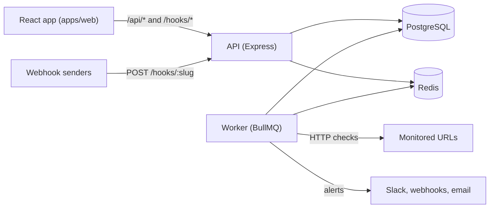
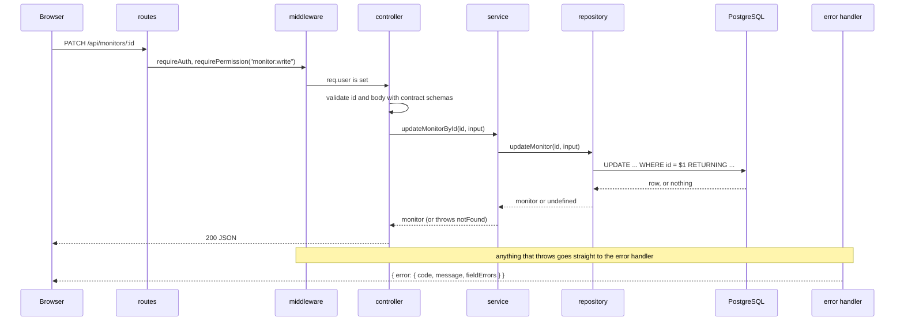

# Pulse backend guide

This guide explains the backend in `apps/api` as it is written. Every file it mentions exists, and every snippet is copied
from the real code. Read it top to bottom once, then use it as a reference while you change things.

For the big picture (requirements, architecture, data model, and the important flows as diagrams) see
[system-design.md](./system-design.md).

---

## Contents

1. [What the backend does](#1-what-the-backend-does)
2. [Run it locally](#2-run-it-locally)
3. [Folder structure](#3-folder-structure)
4. [The layers, following one request](#4-the-layers-following-one-request)
5. [Models and migrations](#5-models-and-migrations)
6. [Errors: throw, and let the database decide](#6-errors-throw-and-let-the-database-decide)
7. [Validation with the shared contracts](#7-validation-with-the-shared-contracts)
8. [Authentication](#8-authentication)
9. [Authorization](#9-authorization)
10. [Background jobs](#10-background-jobs)
11. [Caching](#11-caching)
12. [Rate limiting](#12-rate-limiting)
13. [Invitations, password reset and OAuth](#13-invitations-password-reset-and-oauth)
14. [Testing](#14-testing)
15. [Adding a new feature](#15-adding-a-new-feature)
16. [Going to production](#16-going-to-production)
17. [Troubleshooting](#17-troubleshooting)

---

## 1. What the backend does

Pulse watches HTTP endpoints and incoming webhooks, opens incidents when something breaks, and alerts a team.

The backend is two Node processes that share one code base:

| Process | Started by           | Job                                                                                                    |
| ------- | -------------------- | ------------------------------------------------------------------------------------------------------ |
| API     | `src/server.ts`      | Answers HTTP requests from the frontend and from webhook senders. Must stay fast.                      |
| Worker  | `src/worker.ts`      | Runs slow or scheduled work: HTTP checks, silence detection, alert delivery, cleanup.                  |

They use PostgreSQL for data and Redis for queues, cache and rate-limit counters.



The request and response shapes are defined once in `packages/contracts` (zod schemas). The frontend and the backend
both import them, so they cannot drift apart.

---

## 2. Run it locally

You need Node 26, pnpm and Docker.

```bash
docker compose up -d                       # PostgreSQL 18 on 5432, Redis 8 on 6379
cp apps/api/.env.example apps/api/.env     # then put real secrets in it, see below
pnpm install

pnpm --filter api db:migrate               # create the tables
pnpm --filter api db:seed                  # demo data and demo users

pnpm --filter api dev                      # terminal 1: API on http://localhost:3000
pnpm --filter api worker                   # terminal 2: background worker
pnpm --filter web dev                      # terminal 3: frontend on http://localhost:5173
```

Generate the two secrets with `openssl rand -base64 48` and paste them into `JWT_SECRET` and `INVITE_SECRET`.

Open http://localhost:5173 and sign in as `owner@pulse.dev` / `password123`. The other demo users are
`admin@pulse.dev`, `member@pulse.dev` and `viewer@pulse.dev`, all with the same password.

The frontend talks to the backend through the Vite proxy (`apps/web/vite.config.ts` forwards `/api` and `/hooks` to
port 3000). To go back to the in-browser mock API, set `VITE_API_MOCKING=true` in `apps/web/.env.development`.

Useful commands:

| Command                          | What it does                                            |
| -------------------------------- | ------------------------------------------------------- |
| `pnpm --filter api test`         | Runs all backend tests against the `pulse_test` database |
| `pnpm --filter api typecheck`    | Type-checks without running                              |
| `pnpm --filter api db:generate`  | Creates a new migration after you change a model         |
| `pnpm --filter api db:studio`    | Opens a browser UI for the database                      |
| `curl localhost:3000/api/health` | Shows whether PostgreSQL and Redis are reachable         |

---

## 3. Folder structure

```
apps/api/
├── drizzle.config.ts          drizzle-kit settings (where models and migrations live)
├── vitest.config.ts           test settings, including the test database URL
├── .env.example               every environment variable the app reads
└── src/
    ├── server.ts              starts the API, shuts it down cleanly on SIGTERM
    ├── worker.ts              starts the job workers and schedulers
    ├── app.ts                 builds the Express app: middleware, routers, error handler
    ├── routes.ts              mounts every module router under /api
    ├── config/env.ts          reads and validates environment variables
    ├── db/
    │   ├── client.ts          the Drizzle database connection
    │   ├── migrate.ts         applies migrations
    │   ├── seed.ts            demo data
    │   └── migrations/        SQL generated from the models, committed to git
    ├── models/                Drizzle table definitions (one file per area)
    ├── middleware/            authenticate, rate-limit, error-handler
    ├── security/              passwords, JWT access tokens, refresh cookie, random tokens
    ├── lib/                   small shared helpers (errors, validation, cache, redis, logger)
    ├── jobs/                  queues, schedulers, and one processor per queue
    ├── modules/               one folder per feature
    │   └── monitors/
    │       ├── monitor.routes.ts       URL + middleware -> controller function
    │       ├── monitor.controller.ts   read the request, call the service, send the response
    │       ├── monitor.service.ts      business rules
    │       ├── monitor.repository.ts   database queries
    │       └── monitor.test.ts         tests for this feature
    ├── test/                  test setup and a small HTTP client for tests
    └── types/express.d.ts     tells TypeScript that req.user exists
```

Imports between your own files end in `.ts` (`import { db } from "./db/client.ts"`). Node 26 runs TypeScript directly
by stripping the types, so there is no build step. That also means you cannot use `enum`, `namespace` or constructor
parameter properties; `tsconfig.json` has `erasableSyntaxOnly` turned on so the editor warns you.

---

## 4. The layers, following one request

Every feature uses the same five pieces. Here is what happens for `PATCH /api/monitors/:id`.



### Routes: which URL runs which code

`src/modules/monitors/monitor.routes.ts`

```ts
const canRead = requirePermission("monitor:read");
const canWrite = requirePermission("monitor:write");

export const monitorRouter = Router();

monitorRouter.get("/monitors", requireAuth, canRead, monitorController.list);
monitorRouter.get("/monitors/:id", requireAuth, canRead, monitorController.getOne);
monitorRouter.post("/monitors", requireAuth, canWrite, monitorController.create);
monitorRouter.patch("/monitors/:id", requireAuth, canWrite, monitorController.update);
monitorRouter.delete("/monitors/:id", requireAuth, canWrite, monitorController.remove);
monitorRouter.get("/monitors/:id/checks", requireAuth, canRead, monitorController.listChecks);
```

Read a line left to right: method, path, then middleware in the order they run, then the controller. You can see every
endpoint and who may call it without opening another file. `src/routes.ts` mounts all routers under `/api`.

### Controller: HTTP in, HTTP out

`src/modules/monitors/monitor.controller.ts`

```ts
export const update = async (req: Request, res: Response) => {
  const id = validateId(req.params.id, LABEL);
  const input = validate(updateMonitorSchema, req.body);
  res.json(await monitorService.updateMonitorById(id, input));
};
```

A controller does three things: validate input, call one service function, send the result with the right status code
(`res.status(201).json(...)` for create, `res.status(204).end()` for delete). It never talks to the database and never
contains business rules. There is no `try/catch`: Express 5 forwards errors from `async` handlers to the error handler
for you.

### Service: the rules

`src/modules/monitors/monitor.service.ts`

```ts
export const updateMonitorById = async (id: string, input: UpdateMonitorInput) => {
  const monitor = await updateMonitor(id, input);

  if (!monitor) {
    throw notFound(LABEL);
  }

  if (input.name) {
    await renameIncidentSource(id, input.name);
  }

  await invalidate(cacheKeys.dashboardSummary);

  const alertChannelIds = input.alertChannelIds ?? (await findChannelIdsForMonitor(id));

  return { ...monitor, alertChannelIds };
};
```

The service knows what has to happen around a change: keep incident names in sync, clear the dashboard cache, return
the shape the frontend expects. It knows nothing about HTTP (no `req`, no `res`), so the worker can call services too.

### Repository: the database

`src/modules/monitors/monitor.repository.ts`

```ts
export const updateMonitor = (id: string, input: UpdateMonitorInput) =>
  db.transaction(async (tx) => {
    const { alertChannelIds, ...values } = input;
    const [monitor] = await tx
      .update(monitors)
      .set({ ...values, updatedAt: new Date() })
      .where(eq(monitors.id, id))
      .returning();

    if (monitor && alertChannelIds) {
      await replaceChannelLinks(tx, id, alertChannelIds);
    }

    return monitor;
  });
```

Only repositories import `db`. Each function is one database operation (or one transaction) with a name that says what
it does. When two tables must change together, the repository wraps them in `db.transaction` so either both writes
happen or neither does.

### Model: the table

`src/models/monitor.model.ts` defines the table with Drizzle. See [section 5](#5-models-and-migrations).

### Why there is no "view" or "mapper" layer

Repositories select exactly the fields the API returns, so rows can be sent as they are:

```ts
const alertChannelColumns = {
  id: alertChannels.id,
  name: alertChannels.name,
  isEnabled: alertChannels.isEnabled,
  destination: {
    type: alertChannels.type,
    target: alertChannels.target,
  },
  createdAt: alertChannels.createdAt,
};
```

Drizzle builds the nested `destination` object for you. Dates come back as `Date` objects and `res.json` turns them into
ISO strings like `"2026-11-24T10:15:00.000Z"`, which is what the contract expects. Secrets such as `password_hash` are
never in these column lists, so they cannot leak by accident.

The few fields that do not exist in the database are added in the service, for example the webhook's public URL:

```ts
const withPublicFields = (webhook: WebhookRow, alertChannelIds: string[]) => {
  const { slug, ...fields } = webhook;

  return {
    ...fields,
    ingestUrl: new URL(`/hooks/${slug}`, env.APP_URL).href,
    alertChannelIds,
  };
};
```

### Avoiding N+1 queries

A monitor has many alert channels, stored in the join table `monitor_alert_channels`. Loading the channel ids one
monitor at a time would cost 21 queries for a page of 20 monitors (the "N+1 problem"). The repository loads all of them
in one `IN (...)` query and groups them in memory:

```ts
const links = await db
  .select()
  .from(monitorAlertChannels)
  .where(inArray(monitorAlertChannels.monitorId, monitorIds));

for (const link of links) {
  channelIdsByMonitor.get(link.monitorId)?.push(link.channelId);
}
```

Lists also run the page query and the count query at the same time with `Promise.all`.

---

## 5. Models and migrations

Models live in `src/models/`. A model is a Drizzle table definition:

```ts
export const monitors = pgTable(
  "monitors",
  {
    id: uuid().primaryKey().defaultRandom(),
    name: text().notNull(),
    url: text().notNull(),
    method: httpMethodEnum().notNull(),
    intervalSeconds: integer().notNull(),
    isPaused: boolean().notNull().default(false),
    status: monitorStatusEnum().notNull().default("pending"),
    lastCheckedAt: timestamp({ withTimezone: true }),
    createdAt: timestamp({ withTimezone: true }).notNull().defaultNow(),
  },
  (table) => [index("monitors_due_idx").on(table.isPaused, table.lastCheckedAt)],
);
```

You write property names in camelCase. The database client is created with `casing: "snake_case"`, so `intervalSeconds`
becomes the column `interval_seconds` automatically.

Postgres enums are built from the contract enums (`src/models/enums.ts`), so the database and the API always accept the
same values:

```ts
export const monitorStatusEnum = pgEnum("monitor_status", monitorStatusSchema.enum);
```

### Changing the schema

1. Edit a file in `src/models/`.
2. `pnpm --filter api db:generate --name describe_the_change` writes a new SQL file to `src/db/migrations/`.
3. Read that SQL. Make sure it does what you expect (a rename should not be a drop and add).
4. `pnpm --filter api db:migrate` applies it.
5. Commit the model change and the migration together.

Never edit a migration that has already been applied somewhere. Write a new one.

### The indexes and constraints, and why each exists

| Name                                  | Rule                                                        | Why                                                                         |
| ------------------------------------- | ----------------------------------------------------------- | --------------------------------------------------------------------------- |
| `users_email_unique`                  | unique on `lower(email)`                                    | One account per email, case-insensitive                                     |
| `invitations_one_pending_per_email`   | unique on `email` where `status = 'pending'`                | One open invitation per email                                               |
| `incidents_one_active_per_source`     | unique on `source_id` where `status <> 'resolved'`          | One active incident per monitor or webhook, even if two jobs race           |
| `linked_accounts_provider_account_unique` | unique on `(provider, provider_account_id)`             | A GitHub or Google account belongs to one Pulse user                        |
| `check_results_monitor_time_idx`      | index on `(monitor_id, checked_at desc)`                    | "Checks for this monitor, newest first" reads straight from the index       |
| `monitors_due_idx`                    | index on `(is_paused, last_checked_at)`                     | The worker finds due monitors every 15 seconds                              |
| foreign keys with `on delete cascade` | e.g. deleting a monitor deletes its checks and channel links | No orphaned rows, no cleanup code                                         |

---

## 6. Errors: throw, and let the database decide

### One error shape

Every error response looks like this, and the frontend depends on it:

```json
{ "error": { "code": "VALIDATION_ERROR", "message": "Some fields are invalid", "fieldErrors": { "url": ["Enter a valid http(s) URL"] } } }
```

| `code`             | Status | Meaning                                                            |
| ------------------ | ------ | ------------------------------------------------------------------ |
| `VALIDATION_ERROR` | 400    | Bad input. `fieldErrors` keys match form field names.               |
| `UNAUTHORIZED`     | 401    | Not signed in, or the access token expired. The frontend refreshes. |
| `FORBIDDEN`        | 403    | Signed in, but not allowed.                                          |
| `NOT_FOUND`        | 404    | The record or route does not exist.                                  |
| `CONFLICT`         | 409    | Clashes with current state (duplicate email, invalid transition).    |
| `RATE_LIMITED`     | 429    | Too many attempts. A `Retry-After` header says how long to wait.     |
| `INTERNAL_ERROR`   | 500    | A bug. The message is generic in production.                         |

### Code just throws

`src/lib/errors.ts` has an `AppError` class and helpers: `notFound("Monitor")`, `forbidden(...)`, `conflict(...)`,
`unauthorized(...)`, `badRequest(...)`. Anywhere in a controller or service you `throw` one, and
`src/middleware/error-handler.ts` turns it into the response above. Nothing else formats errors.

### Let the database decide instead of checking first

A common beginner pattern is "look it up, then decide":

```ts
const existing = await findUserByEmail(email);
if (existing) throw conflict("Email already in use");
await insertUser(...);
```

It costs an extra query and it is still wrong: two requests can both pass the check and both insert. The database
already enforces the rule with a unique index, so Pulse just writes and lets the constraint answer.
`src/lib/database-errors.ts` maps the Postgres error to the right API error by constraint name:

```ts
const errorsByConstraint: Record<string, () => AppError> = {
  users_email_unique: () => conflict("Email already in use", { email: ["An account with this email already exists"] }),
  invitations_one_pending_per_email: () =>
    conflict("Already invited", { email: ["An invitation is already pending for this email"] }),
  linked_accounts_provider_account_unique: () => conflict("This account is already connected to another user"),
  monitor_alert_channels_channel_id_alert_channels_id_fk: unknownAlertChannel,
  webhook_alert_channels_channel_id_alert_channels_id_fk: unknownAlertChannel,
};
```

So registering with a taken email is simply:

```ts
const user = await insertUser({ name, email, role, passwordHash });
```

If the email exists, Postgres raises error `23505` on `users_email_unique`, the error handler returns `409` with the
field error, and the frontend shows it under the email input. An unknown alert channel id raises a foreign-key error
(`23503`) and becomes a `400` on `alertChannelIds`.

The same idea works for "not found". Updates and deletes use `RETURNING`; no row back means no such record:

```ts
const channel = await deleteAlertChannel(id);

if (!channel) {
  throw notFound(LABEL);
}
```

And for rules about the current state, put the rule in the `WHERE` clause so the check and the write are one atomic
statement. Revoking an invitation only touches pending, unexpired rows:

```ts
.update(invitations)
.set({ status: "revoked" })
.where(and(eq(invitations.id, id), isPending()))
.returning({ id: invitations.id });
```

Only when that returns nothing does the service read the row, to explain why (`409 "Cannot revoke an invitation that is
accepted"` or `404`). The read happens on the failure path only. Incident transitions and member role changes work the
same way.

Some rules span tables and cannot be an index, for example "you cannot invite someone who already has an account".
Those keep one explicit check.

---

## 7. Validation with the shared contracts

Never trust `req.body`. Every controller parses input with a schema from `@pulse/contracts`:

```ts
const input = validate(createMonitorSchema, req.body);
const query = validateQuery(monitorListQuerySchema, req.query);
const id = validateId(req.params.id, "Monitor");
```

`src/lib/validate.ts` runs `schema.safeParse`. On failure it throws a `400` with field errors built from the zod
issues. On success you get typed data, with unknown keys stripped (a client cannot sneak in `role: "owner"`), strings
trimmed, emails lowercased, and query strings like `"2"` coerced to numbers.

`validateId` turns a malformed id into a `404` before it reaches Postgres, which would otherwise fail with "invalid input
syntax for type uuid".

Environment variables are validated the same way at startup in `src/config/env.ts`. A missing `DATABASE_URL` stops the
process immediately with a clear message.

---

## 8. Authentication

### Two tokens

|                 | Access token                       | Refresh token                                       |
| --------------- | ---------------------------------- | --------------------------------------------------- |
| What            | Signed JWT with the user id        | 32 random bytes                                     |
| Lives for       | 15 minutes                         | 7 days                                              |
| Browser keeps it | In memory                         | `httpOnly` cookie `pulse_refresh`, path `/api/auth` |
| Server stores   | Nothing                            | SHA-256 hash in `sessions`                          |
| Revocable       | No, it expires                     | Yes                                                 |

The access token is checked on every request with only a signature check (`src/security/access-token.ts`). Because it
cannot be revoked it is short-lived. The refresh token is checked against the database, so logout, "sign out
everywhere" and password changes can kill it.

### Passwords

`src/security/passwords.ts` uses Argon2id via `@node-rs/argon2`. Argon2 is slow on purpose so a leaked database is
expensive to crack. When a login email does not exist, the code still runs one Argon2 verify against a dummy hash, so the
response time does not reveal which emails have accounts. The error message is the same in both cases.

### Refresh token rotation

`src/modules/auth/auth.service.ts`, function `refresh`:

1. Find the session by `sha256(token)`. Missing or expired: `401`.
2. Already revoked: someone is reusing an old token. That means it was probably stolen, so revoke every session in its
   family (all tokens descended from that one login) and return `401`.
3. Otherwise, in one transaction, revoke this session and insert a new one in the same family. The revoke uses
   `WHERE revoked_at IS NULL`; if two refreshes race, only one wins and the other gets `401`.
4. Return a new access token and set the new refresh cookie.

The frontend calls refresh on page load and whenever a request returns `401`, and it de-duplicates concurrent refresh
calls, so normal use never trips reuse detection.

### Ending sessions immediately

An access token is valid for 15 minutes and is never looked up in the database, so revoking refresh tokens alone would
leave other devices signed in until their access token expires. "Sign out everywhere", a password change and a password
reset therefore also record a timestamp in Redis (`auth:sessions-revoked-at:<userId>`, kept for 15 minutes,
`src/security/session-revocation.ts`). Every access token carries the millisecond it was issued (`issuedAtMs`), and
`requireAuth` rejects tokens issued before that timestamp. The device that made the change gets a fresh refresh cookie
in the same response, so it recovers on its next request through the normal 401-then-refresh path.

### The cookie

`src/security/refresh-cookie.ts` sets `httpOnly` (JavaScript cannot read it), `sameSite: "lax"` (not sent on cross-site
POSTs), `secure` in production (HTTPS only) and `path: "/api/auth"` (only sent to auth endpoints).

### Endpoints

| Endpoint                         | Notes                                                                       |
| -------------------------------- | --------------------------------------------------------------------------- |
| `POST /api/auth/register`        | First user ever becomes `owner`, everyone after is `viewer`. 201.           |
| `POST /api/auth/login`           | Rate limited. Same 401 for unknown email and wrong password.                |
| `POST /api/auth/refresh`         | Rotates the cookie. 401 clears the cookie.                                  |
| `POST /api/auth/logout`          | Revokes the current session. Works with an expired access token.            |
| `POST /api/auth/logout-all`      | Revokes every session of the user.                                          |
| `POST /api/me/password`          | Verifies the current password, revokes all sessions, issues a fresh cookie. |

---

## 9. Authorization

Roles and permissions come from the contract (`packages/contracts/src/rbac/permissions.ts`):

| Permission            | owner | admin | member | viewer |
| --------------------- | :---: | :---: | :----: | :----: |
| `monitor:read`        |   ✓   |   ✓   |   ✓    |   ✓    |
| `monitor:write`       |   ✓   |   ✓   |   ✓    |        |
| `webhook:read`        |   ✓   |   ✓   |   ✓    |   ✓    |
| `webhook:write`       |   ✓   |   ✓   |   ✓    |        |
| `alert-channel:read`  |   ✓   |   ✓   |   ✓    |   ✓    |
| `alert-channel:write` |   ✓   |   ✓   |        |        |
| `incident:read`       |   ✓   |   ✓   |   ✓    |   ✓    |
| `incident:manage`     |   ✓   |   ✓   |   ✓    |        |
| `member:read`         |   ✓   |   ✓   |   ✓    |   ✓    |
| `member:manage`       |   ✓   |   ✓   |        |        |

Two middleware functions in `src/middleware/authenticate.ts` enforce it:

- `requireAuth` reads `Authorization: Bearer <token>`, verifies the JWT, loads the user (cached for 60 seconds) and sets
  `req.user`. Failure: `401`.
- `requirePermission("monitor:write")` checks the role. Failure: `403`.

401 means "I do not know who you are" and makes the frontend refresh the session. 403 means "I know you, and no". Mixing
them up causes refresh loops.

The role is loaded from the database (through the cache), not stored in the JWT, so a demotion takes effect within a
minute instead of when the token expires. Changing a role clears that user's cache entry, so in practice it is
immediate.

Rules about specific records live in services:

| Rule                                         | Where                     | How                                                     |
| -------------------------------------------- | ------------------------- | ------------------------------------------------------- |
| The owner can never be changed or removed    | `member.service.ts`       | `WHERE role <> 'owner'` in the update and delete         |
| You cannot change your own role or remove yourself | `member.service.ts` | compare ids before writing                              |
| Nobody can be made owner                     | contract                  | `assignableRoleSchema` rejects `owner` with a 400        |
| A disabled channel cannot send a test alert  | `alert-channel.service.ts` | `409`                                                  |

The frontend hides buttons a role cannot use, but that is only convenience. The server enforces every rule, because
anyone can call the API with curl.

---

## 10. Background jobs

### Why a separate worker

An HTTP check can take up to 30 seconds. Doing that inside the API would slow every user request, and a crash in check
code would take the API down. The worker does slow work; the API only puts jobs on a queue.

### The pieces

| File                                    | Role                                                              |
| --------------------------------------- | ----------------------------------------------------------------- |
| `src/jobs/queues.ts`                    | Creates three BullMQ queues in Redis: `checks`, `alerts`, `maintenance` |
| `src/jobs/schedulers.ts`                | Registers repeating jobs                                          |
| `src/jobs/processors/*.processor.ts`    | One function per queue that looks at `job.name` and calls a service |
| `src/worker.ts`                         | Starts a BullMQ `Worker` for each queue                           |

| Job                      | When                    | What it does                                                                    |
| ------------------------ | ----------------------- | ------------------------------------------------------------------------------- |
| `dispatch-due-checks`    | every 15 s              | Finds monitors whose interval has passed and enqueues one `run-check` each       |
| `run-check`              | enqueued by the above   | Calls the URL, saves the result, updates uptime, opens or resolves an incident   |
| `detect-silent-webhooks` | every 60 s              | Marks webhooks with no event inside their window as `silent`, opens incidents    |
| `send-alert`             | when an incident opens or resolves, or on "test" | Delivers to one channel, retried 5 times with exponential backoff |
| `cleanup`                | daily at 03:00          | Deletes checks older than 30 days, old sessions, used reset tokens               |

Schedules are stored in Redis, not in a `setInterval`, so they survive restarts and run once even with several workers.

### Making jobs safe to run twice

Background work must be idempotent: running it twice should not double the effect.

- `run-check` jobs get a deterministic id, `check-<monitorId>-<interval bucket>`. BullMQ ignores a second job with the
  same id, so a slow check is never queued twice.
- Opening an incident is a plain insert. If an active incident already exists for that source, the partial unique index
  `incidents_one_active_per_source` rejects it and the code treats that as "already open". No duplicate alerts.
- Resolving is `UPDATE ... WHERE source_id = $1 AND status <> 'resolved' RETURNING`. If nothing comes back, there was
  nothing to resolve.

### Checks

`src/modules/monitors/http-check.ts` decides the outcome:

| Result                                     | Outcome    |
| ------------------------------------------ | ---------- |
| Expected status, faster than half the timeout | `up`    |
| Expected status, slower than half the timeout | `degraded` |
| Different status, timeout, connection error | `down`    |

`saveCheckResult` inserts the result and recomputes the 24-hour uptime in the same transaction, so the monitor list
never has to compute it ("precompute on write, read cheaply").

### Alerts

One job per channel, so a broken Slack URL retries on its own without re-sending the email. Slack gets `{ "text": ... }`,
webhooks get `{ event, message, incident, sentAt }`. Email is written to the worker log; plug a provider in
`alert-delivery.service.ts` when you have one.

---

## 11. Caching

`src/lib/cache.ts` implements cache-aside: read from Redis; on a miss, load from the database and store it with a TTL.

| Data              | Key                       | TTL  | Cleared when                                              |
| ----------------- | ------------------------- | ---- | --------------------------------------------------------- |
| Dashboard summary | `cache:dashboard:summary` | 30 s | Monitors, webhooks or incidents change, or a check runs   |
| Signed-in user    | `cache:user:<id>`         | 60 s | Role, name or email changes, a password reset, or the user is removed |

The dashboard summary is fetched on every page (the header status pill and the sidebar badge use it), and the user
lookup runs on every request, so both are read far more often
than they change. The TTL is a safety net: if an invalidation is ever missed, the data heals itself within seconds.

Do not cache things where stale data is dangerous, such as whether a session is revoked.

---

## 12. Rate limiting

`src/middleware/rate-limit.ts` is a fixed-window counter in Redis: `INCR` the key, set its expiry on the first hit,
reject when the count passes the limit. Redis counters are atomic, so the limit holds across several API instances.

| Route                         | Limit       | Counted per |
| ----------------------------- | ----------- | ----------- |
| `POST /auth/login`            | 5 / minute  | email       |
| `POST /auth/login`            | 20 / minute | IP          |
| `POST /auth/register`         | 10 / hour   | IP          |
| `POST /auth/password/forgot`  | 3 / minute  | email       |
| OAuth endpoints               | 20 / minute | IP          |
| Invitation preview and accept | 30 / minute | IP          |
| `ANY /hooks/:slug`            | 120 / minute | slug       |
| Everything under `/api`       | 300 / minute | IP         |

A blocked request gets `429` and a `Retry-After` header; the login form shows "Try again in 41s."

`app.set("trust proxy", 1)` makes `req.ip` the real client IP behind one proxy (the Vite proxy in development, a load
balancer in production).

---

## 13. Invitations, password reset and OAuth

### Invitations

1. An admin posts `{ email, role }`. The service rejects emails that already have an account; the partial unique index
   rejects a second pending invite. Expired pending invites for that email are marked `expired` first so they do not
   block a new one.
2. The invite link is `APP_URL/invite/<id>.<hmac>`, where the HMAC is computed with `INVITE_SECRET`
   (`src/modules/invitations/invitation-token.ts`). Nothing secret is stored; the server can rebuild the link at any
   time and detects any tampering. The comparison uses `timingSafeEqual`.
3. The invitee opens the link; the frontend calls `GET /api/invitations/preview/:token`.
4. `POST /api/invitations/accept` marks the invitation accepted and creates the user in one transaction, then signs them
   in.

In development the invite link is printed in the API log.

### Password reset

`POST /api/auth/password/forgot` always answers `204`, whether or not the email exists, so it cannot be used to find
accounts. If the user exists, a random token is created (stored as a hash, valid for 30 minutes) and the reset link is
printed in the API log. `POST /api/auth/password/reset` sets the new password, marks the token used and revokes every
session, all in one transaction.

### OAuth with GitHub and Google

The buttons work once you register OAuth apps and fill the four `*_CLIENT_ID` / `*_CLIENT_SECRET` variables. Without
them the endpoints answer `404 "Sign-in with github is not configured on this server"`.

| | GitHub | Google |
|---|---|---|
| Where | Settings → Developer settings → OAuth Apps | Google Cloud Console → APIs & Services → Credentials → OAuth client ID (Web) |
| Callback URL | `http://localhost:5173/oauth/callback/github` | `http://localhost:5173/oauth/callback/google` |

The flow (`src/modules/oauth/`):

1. `authorize` creates a random `state` and a PKCE `codeVerifier`, stores them in Redis for 10 minutes and returns the
   provider URL. `state` stops login CSRF; PKCE stops a stolen code from being used.
2. The provider sends the browser back to the frontend, which posts `code` and `state` to `callback`.
3. `callback` reads and deletes the state (`GETDEL`, single use), exchanges the code, fetches a **verified** email and
   finds or creates the user. Unverified emails are refused, otherwise someone could claim your email on the provider
   and take over your account.

---

## 14. Testing

There are two layers. This section covers the backend's own tests; the end-to-end suite in `e2e/` (the running API and
worker, plus the browser) is described in the [README](../README.md#end-to-end-tests).

```bash
pnpm --filter api test
```

Tests run against a separate database, `pulse_test` (created by `apps/api/docker/create-test-db.sql` when the Postgres
container first starts), and Redis database 1. Settings are in `vitest.config.ts`, so tests work on a fresh clone and in
CI without a `.env` file. `src/test/setup.ts` applies migrations once and empties every table before each test.

| File                                  | What it proves                                                              |
| ------------------------------------- | --------------------------------------------------------------------------- |
| `modules/auth/auth.test.ts`           | owner bootstrap, duplicate email, same 401 for both login failures, rotation, reuse detection, rate limit |
| `middleware/authenticate.test.ts`     | 401 without or with a forged token, viewer and member permissions           |
| `modules/monitors/monitor.test.ts`    | validation errors, unknown channel, full CRUD, malformed id                 |
| `modules/monitors/http-check.test.ts` | up, down, degraded and timeout against a local HTTP server                  |
| `modules/incidents/incident.test.ts`  | one active incident per source, resolve on recovery, transition rules       |
| `modules/invitations/invitation.test.ts` | invite, preview, accept, tampered token, duplicate, revoke, re-invite after expiry |
| `modules/members/member.test.ts`      | owner and self protection, role change takes effect immediately             |
| `modules/webhooks/webhook.test.ts`    | raw payload is stored exactly, unknown slug is 404                          |

Most tests go through real HTTP (`src/test/client.ts` starts the app on a random port), so they cover routes,
middleware, validation, services, the database and the error handler together.

---

## 15. Adding a new feature

Say you want "maintenance windows" for monitors.

1. **Contract.** Add the zod schemas to `packages/contracts` (`createMaintenanceWindowSchema`, the item shape).
2. **Model.** Add a table in `src/models/`, export it from `src/models/index.ts`, run `db:generate`, read the SQL, run
   `db:migrate`. Put rules into the database where you can: unique indexes, foreign keys, `NOT NULL`.
3. **Repository.** `src/modules/maintenance-windows/maintenance-window.repository.ts`: one function per query, select
   only the columns the API returns, use `RETURNING`.
4. **Service.** Business rules. Throw `notFound`, `forbidden`, `conflict`. Clear caches that depend on the data.
5. **Controller.** Validate with the contract schema, call the service, send the status code.
6. **Routes.** One line per endpoint with `requireAuth` and `requirePermission`. Mount the router in `src/routes.ts`.
7. **Errors.** If you added a unique index or foreign key that users can hit, add its name to `errorsByConstraint` in
   `src/lib/database-errors.ts` with a friendly message.
8. **Tests.** A `*.test.ts` next to the code using `useTestServer()` and `request()`.

---

## 16. Going to production

Already handled:

- Environment validated at startup; secrets come only from the environment.
- `helmet` security headers, `cors` locked to `APP_URL` with credentials, `x-powered-by` off.
- JSON bodies limited to 100 KB, webhook bodies to 1 MB.
- Structured JSON logs (`pino`) with `Authorization`, cookies and `Set-Cookie` redacted; request logging via `pino-http`.
  Logs are pretty-printed only in an interactive terminal; when output is piped (containers, log collectors, the E2E
  suite) they are one JSON object per line.
- Generic error messages in production; stack traces only in logs.
- `secure` cookies in production.
- Graceful shutdown on `SIGTERM` for both processes: stop taking work, finish in-flight work, close connections.
- `GET /api/health` returns `503` when PostgreSQL or Redis is down, for load balancer checks.
- SSRF guard (`src/lib/outbound-url.ts`): in production, checks and alert webhooks refuse private, loopback and
  link-local addresses.
- Completed and failed jobs are trimmed (last 100 and 500 kept) so Redis does not grow forever.
- Data retention: old checks, sessions and reset tokens are deleted daily.

Still to do for a real deployment:

- Run `pnpm --filter api db:migrate` as a release step before starting new API instances.
- Plug in an email provider for alerts, invitations and password resets (they are logged today).
- Serve over HTTPS and set `NODE_ENV=production`.
- Put the API behind exactly one proxy (or change `trust proxy` to match).
- The SSRF guard checks the address before connecting; a hostile DNS server could still answer differently on the
  second lookup (DNS rebinding). For strong isolation, run the worker in a network that cannot reach internal services.

---

## 17. Troubleshooting

**"Unable to reach the server" in the frontend.** The API is not running on port 3000, or it crashed on startup. Read
its terminal. `curl localhost:3000/api/health` should answer.

**Signed out after every reload.** The refresh cookie is not stored. Use the app through `localhost:5173` (the proxy), not
port 3000 directly. In DevTools → Application → Cookies, `pulse_refresh` should exist with path `/api/auth`.

**Every request returns 401 right after login.** `JWT_SECRET` differs between processes, or the clock is wrong.

**Monitors stay `pending`.** The worker is not running, or Redis is down. Start `pnpm --filter api worker` and check
`docker compose ps`.

**`Invalid environment variables` on startup.** The message names the variable. Compare `.env` with `.env.example`.

**`ERR_UNSUPPORTED_TYPESCRIPT_SYNTAX`.** You used `enum`, `namespace` or a parameter property, or a relative import
without `.ts`. Run `pnpm --filter api typecheck`.

**A form shows no error but the request failed.** The `fieldErrors` key does not match the form field name.

**`409 This record already exists` with no field error.** A unique constraint fired that is not in `errorsByConstraint`.
Add it there with a clear message.

**Tests fail with "database pulse_test does not exist".** The init script only runs when the Postgres volume is first
created. Create it once with `docker compose exec postgres createdb -U pulse pulse_test`.
