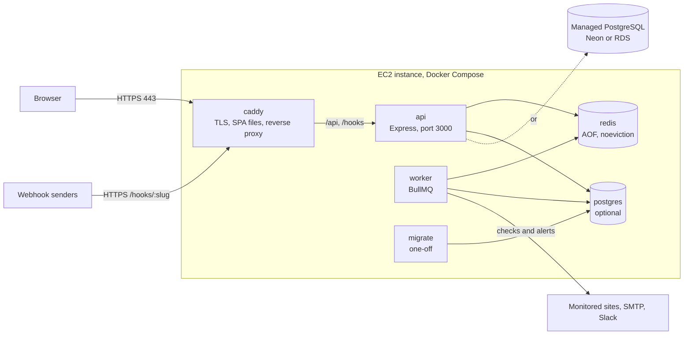

# Deploying Pulse

> **Status: nothing is deployed yet.** This guide and the files in `deploy/` describe how to run Pulse on one Linux
> virtual machine (an AWS EC2 instance in the examples). No server, DNS record, registry or secret exists yet. The
> deploy workflow is manual and stays inactive until someone sets it up.

## Contents

1. [What runs where](#1-what-runs-where)
2. [Files](#2-files)
3. [Choosing a server](#3-choosing-a-server)
4. [First deploy](#4-first-deploy)
5. [Environment reference](#5-environment-reference)
6. [Using a managed database (Neon, RDS)](#6-using-a-managed-database-neon-rds)
7. [Updates and rollbacks](#7-updates-and-rollbacks)
8. [CI and the optional deploy workflow](#8-ci-and-the-optional-deploy-workflow)
9. [Backups and restore](#9-backups-and-restore)
10. [Monitoring](#10-monitoring)
11. [Scaling](#11-scaling)
12. [Free and cheap options](#12-free-and-cheap-options)
13. [Troubleshooting](#13-troubleshooting)

## 1. What runs where



Six Compose services run on one machine. Only Caddy publishes ports (80 and 443, plus 443/udp for HTTP/3).

| Service | Image | Does |
| ------- | ----- | ---- |
| `caddy` | `pulse-web` | Gets and renews a Let's Encrypt certificate, serves the built SPA, proxies `/api` and `/hooks` to the API |
| `migrate` | `pulse-api` | Runs `node src/db/migrate.ts` and exits. `api` and `worker` wait for it to finish successfully |
| `api` | `pulse-api` | `node src/server.ts` |
| `worker` | `pulse-api` | `node src/worker.ts` |
| `redis` | `redis:8-alpine` | Queues, rate limits, cache, pub/sub for live updates. Password protected, append-only file on a volume, `maxmemory-policy noeviction` (BullMQ requires it) |
| `postgres` | `postgres:18-alpine` | Only with the `local-db` profile. Leave it off when you use a managed database |

### Why Caddy in front

The browser has to see the API on the same origin as the app. The refresh cookie is scoped to `/api/auth`, and the SPA
calls relative `/api` URLs. Caddy gives one origin with little configuration (`deploy/Caddyfile`):

- `/api/events` is proxied with `flush_interval -1` and no `encode`, so the live updates stream is neither buffered nor
  compressed. The API also sends `Cache-Control: no-cache, no-transform` and `X-Accel-Buffering: no`.
- `/api/*` and `/hooks/*` are proxied with gzip/zstd compression.
- `/assets/*` (Vite's hashed files) get `Cache-Control: public, max-age=31536000, immutable`. A missing asset returns
  404, not the app shell.
- Every other path falls back to `index.html` with `Cache-Control: no-cache`, so client routes like `/monitors/123` and
  `/status` work on reload and a new release shows up on the next navigation.
- `/metrics` returns 404 publicly. Scrape it from inside the server (see [Monitoring](#10-monitoring)).
- Caddy writes no access log. Request URLs contain webhook slugs and invitation tokens, and the API's own logs mask them.

Caddy sets `X-Forwarded-For` to the client address and drops any value the client sent, so the API trusts exactly one
hop (`TRUST_PROXY=1`).

## 2. Files

| Path | Purpose |
| ---- | ------- |
| `Dockerfile` | Multi-stage build with two targets: `api` (API, worker and migrations) and `web` (Caddy plus the built SPA) |
| `.dockerignore` | Keeps `node_modules`, `.git`, `dist`, `e2e`, docs and `.env` files out of the build context |
| `deploy/compose.production.yml` | The production stack |
| `deploy/Caddyfile` | Routing, caching and streaming rules, baked into the `web` image |
| `deploy/.env.production.example` | Every production variable. Copy it to `deploy/.env` on the server |
| `deploy/bootstrap.sh` | Prepares a fresh Ubuntu server |
| `deploy/deploy.sh` | Switches to a new image tag, waits for health checks, rolls back on failure |
| `deploy/backup.sh` | `pg_dump` of the local database to a dated file, optional upload to S3 |
| `.github/workflows/ci.yml` | Lint, typecheck, backend tests, Playwright, Docker builds |
| `.github/workflows/deploy.yml` | Optional manual deploy over SSH |
| `.github/dependabot.yml` | Weekly grouped updates for npm, Actions, the Dockerfile and Compose images |

### The images

`pulse-api` is built on `node:26-bookworm-slim`. It uses Debian rather than Alpine because `@node-rs/argon2` ships
prebuilt binaries for glibc, and the build installs the matching `linux-x64-gnu` or `linux-arm64-gnu` package. The image
holds only production dependencies: pnpm installs `--prod --filter api...`, keeping the workspace layout so
`@pulse/contracts` stays a symlink to `packages/contracts`. Node refuses to strip types from files under
`node_modules`, which is why `pnpm deploy` is not used. Test files, npm, npx, corepack and yarn are removed. The image
sets `NODE_ENV=production`, runs as the `node` user, and starts `node` directly as PID 1. The app handles `SIGTERM`
itself and does not spawn children, so no init process is needed. Its `HEALTHCHECK` calls `/api/health/live`. Size is
about 310 MB, most of which is the Node base image.

`pulse-web` is `caddy:2.11-alpine` with the Caddyfile and `apps/web/dist`. It runs as a non-root `caddy` user and its
health check calls Caddy's admin endpoint on `127.0.0.1:2019`. Size is about 65 MB.

Build both from the repository root:

```bash
docker build --target api -t pulse-api .
docker build --target web -t pulse-web .
```

## 3. Choosing a server

**Recommended: `t3.small` (2 vCPU, 2 GB RAM, x86) with a 20 GB gp3 volume**, Ubuntu 24.04 LTS.

Expect the API and worker to use roughly 100 to 150 MB each, Caddy about 30 MB, Redis a few MB, and Postgres 100 to
200 MB plus its cache. Check with `docker stats` once you have real traffic. 2 GB holds all of that plus the occasional image build. With a managed
database, a `t3.micro` (1 GB) plus the 2 GB swap file from `bootstrap.sh` also works, but build images in CI rather
than on the server.

`t4g` (ARM) instances are cheaper per GB. They work if you build on the server. The deploy workflow builds `linux/amd64`
only, so add `platforms: linux/arm64` to its build steps before you use it with an ARM instance.

### Security group

| Direction | Port | Source | Why |
| --------- | ---- | ------ | --- |
| Inbound | 22/tcp | Your IP only | SSH. Widen to GitHub's runner ranges or use a bastion only if you enable the deploy workflow |
| Inbound | 80/tcp | 0.0.0.0/0, ::/0 | ACME HTTP challenge and redirect to HTTPS |
| Inbound | 443/tcp | 0.0.0.0/0, ::/0 | HTTPS |
| Inbound | 443/udp | 0.0.0.0/0, ::/0 | HTTP/3 (optional) |
| Outbound | all | 0.0.0.0/0 | Checks, SMTP, Let's Encrypt, image pulls |

Postgres and Redis are not published on the host. Keep it that way. Docker publishes ports by writing iptables rules
ahead of `ufw`, so the security group is the firewall that counts.

### DNS

Allocate an Elastic IP, attach it to the instance, and create an `A` record (and `AAAA` if you use IPv6) for your
domain, for example `pulse.example.com`. Caddy requests the certificate on first start, so the record must resolve
before then.

## 4. First deploy

1. **Launch the instance** (section 3) and SSH in as `ubuntu`.

2. **Bootstrap it.** Copy `deploy/bootstrap.sh` up and run it:

   ```bash
   sudo bash bootstrap.sh
   ```

   It installs Docker Engine and the Compose plugin, sets Docker log limits, creates a `deploy` user in the `docker`
   group (with the same SSH keys as `ubuntu`), disables SSH passwords and root login, allows only 22, 80 and 443 in
   `ufw`, adds a 2 GB swap file if there is none, and enables unattended security upgrades and fail2ban. Override with
   `DEPLOY_USER`, `DEPLOY_PATH` (default `/opt/pulse`) and `SWAP_SIZE`.

3. **Get the code onto the server** as the `deploy` user:

   ```bash
   git clone https://github.com/<owner>/pulse.git /opt/pulse
   cd /opt/pulse/deploy
   cp .env.production.example .env
   chmod 600 .env
   ```

   With the deploy workflow you only need the `deploy/` folder; the workflow copies it on every run.

4. **Fill in `.env`.** At minimum: `DOMAIN`, `JWT_SECRET`, `INVITE_SECRET`, `ENCRYPTION_KEY`, `REDIS_PASSWORD`, the database settings,
   `MAIL_FROM` and the `SMTP_*` values. Generate secrets with:

   ```bash
   openssl rand -base64 48   # JWT_SECRET, INVITE_SECRET (once each)
   openssl rand -base64 32   # ENCRYPTION_KEY
   openssl rand -hex 32      # REDIS_PASSWORD, POSTGRES_PASSWORD, METRICS_TOKEN
   ```

   Use hex for the two passwords because they end up inside connection URLs.

5. **Build and start:**

   ```bash
   docker compose -f compose.production.yml build
   docker compose -f compose.production.yml up -d --wait
   ```

   Compose starts Redis (and Postgres with the `local-db` profile), runs `migrate`, then starts `api` and `worker` once
   migrations succeed, then Caddy once the API is ready. `--wait` returns when every health check passes.

6. **Create the owner.** Sign-up is off in production (`OWNER_SIGNUP_ENABLED=false`). The image has no pnpm, so call the
   script with node:

   ```bash
   read -rs OWNER_PASSWORD && export OWNER_PASSWORD
   docker compose -f compose.production.yml run --rm --no-deps -e OWNER_PASSWORD \
     api node src/scripts/create-owner.ts --email you@example.com --name "Your Name"
   unset OWNER_PASSWORD
   ```

7. **Check it:**

   ```bash
   curl https://pulse.example.com/api/health
   # {"status":"ok","database":"ok","redis":"ok","worker":"up",...}
   ```

   Open `https://pulse.example.com`, sign in, and check that the header shows **Live**.

8. **OAuth (optional).** Register the callback URLs `https://<domain>/oauth/callback/github` and
   `https://<domain>/oauth/callback/google` with the provider, put the client ID and secret in `.env`, and run
   `docker compose -f compose.production.yml up -d`.

9. **Schedule backups** if you run the local database (section 9).

## 5. Environment reference

`deploy/.env.production.example` lists every variable. The README's configuration tables describe what each one does.
These are the ones that matter for this stack:

| Variable | Value in production |
| -------- | ------------------- |
| `DOMAIN` | Public hostname. Caddy's site address and the default `APP_URL` (`https://$DOMAIN`) |
| `APP_URL`, `SITE_ADDRESS` | Leave empty unless the public URL differs from `https://$DOMAIN` |
| `NODE_ENV` | Set to `production` by the Compose file |
| `JWT_SECRET`, `INVITE_SECRET` | `openssl rand -base64 48`. Changing `JWT_SECRET` signs everyone out |
| `ENCRYPTION_KEY` | 32 random bytes, base64 (`openssl rand -base64 32`). Encrypts secret monitor request headers. Back it up: losing it makes those headers unreadable |
| `REDIS_PASSWORD` | `openssl rand -hex 32`. The Compose file builds `REDIS_URL` from it |
| `REDIS_MAXMEMORY` | Default `256mb`. With `noeviction`, Redis refuses writes when full rather than dropping jobs |
| `COMPOSE_PROFILES`, `POSTGRES_PASSWORD` | `local-db` and a hex password for the bundled database |
| `DATABASE_URL`, `DATABASE_MIGRATION_URL` | Only for a managed database (section 6). Empty `DATABASE_URL` means the bundled one |
| `TRUST_PROXY` | `1` (Caddy). Add one for each extra proxy, such as an ALB or CloudFront in front of Caddy |
| `METRICS_TOKEN` | `openssl rand -hex 32` to enable `/metrics` |
| `MAIL_FROM`, `SMTP_HOST`, `SMTP_PORT`, `SMTP_SECURE`, `SMTP_USER`, `SMTP_PASSWORD` | Required. The API refuses to start in production without `SMTP_HOST` and `MAIL_FROM` |
| `OWNER_SIGNUP_ENABLED` | `false` |
| `ALLOW_PRIVATE_NETWORK_TARGETS` | `false`. Turning it on lets monitors reach the instance metadata service and Redis |
| `PULSE_API_IMAGE`, `PULSE_WEB_IMAGE`, `PULSE_TAG` | Which images to run. `deploy.sh` rewrites `PULSE_TAG` |

### Email

There is no email service in this stack. Any SMTP provider works. Resend, Brevo, Postmark and Amazon SES all offer SMTP
with a free or low-cost tier. Verify your sending domain with the provider (SPF and DKIM records), then set for example:

```bash
MAIL_FROM=Pulse <alerts@pulse.example.com>
SMTP_HOST=smtp.resend.com
SMTP_PORT=587
SMTP_SECURE=false
SMTP_USER=resend
SMTP_PASSWORD=<api key>
```

Use port 587 with `SMTP_SECURE=false` (STARTTLS) or 465 with `SMTP_SECURE=true`. AWS blocks outbound port 25 on EC2 by
default, and you don't need it.

## 6. Using a managed database (Neon, RDS)

Remove the `COMPOSE_PROFILES=local-db` line and set `DATABASE_URL`. The Postgres container then never starts.

**TLS.** postgres.js reads `sslmode` from the URL, so `?sslmode=require` (which Neon includes in its connection strings)
turns TLS on. Nothing in the code needs to change. A URL without `sslmode`, like the bundled database's, connects
without TLS. For RDS, append `?sslmode=require`.

**Direct or pooled.** Use the direct (non-pooled) connection string. Each API and worker process keeps up to 10
connections, so the default stack needs about 20, well within what a small Neon or RDS instance allows.

If you want the pooled endpoint (Neon's `-pooler` host, RDS Proxy or PgBouncer in transaction mode):

- Append `&prepare=false` to `DATABASE_URL`. Transaction pooling breaks named prepared statements, and postgres.js
  reads `prepare` from the URL.
- Put the direct URL in `DATABASE_MIGRATION_URL`. `src/db/migrate.ts` uses it when set, so migrations never run through
  the pooler.

The app holds no session state in Postgres. Its only locks are `pg_advisory_xact_lock` (released at commit), and live
updates use Redis pub/sub, not `LISTEN`. That makes transaction pooling safe.

**Neon setup.** Create a project in the AWS region nearest your instance (for an instance in `us-east-1`, pick Neon's
US East (N. Virginia)). Copy the connection string from the dashboard with "Connection pooling" off for
`DATABASE_URL`.

**Neon free tier.** Free compute suspends after a few minutes idle. Pulse never idles: the worker queries every 15
seconds (`CHECK_DISPATCH_INTERVAL_MS`), so the compute runs around the clock, about 730 hours a month. That is more
than the free tier's monthly compute allowance at most compute sizes. Expect to need a paid Neon plan for a real
deployment, or accept that the database stops when the allowance runs out. Check Neon's pricing page for current
limits.

## 7. Updates and rollbacks

### Updating on the server

```bash
cd /opt/pulse && git pull
cd deploy
docker compose -f compose.production.yml build
docker compose -f compose.production.yml up -d --wait
```

`up` recreates the changed containers. `migrate` runs again first, and the new API starts only if migrations succeed.
On one machine there is a short gap (a few seconds) while the API restarts. Browsers reconnect the live stream on their
own.

### Updating with tagged images

When images come from a registry, tag them with the commit SHA and run:

```bash
bash /opt/pulse/deploy/deploy.sh <sha>
```

`deploy.sh` records the current `PULSE_TAG`, writes the new one to `.env`, pulls, runs `up -d --wait` (migrations
included), then calls `/api/health/ready` through Caddy. If any step fails, it prints the last 100 log lines of
`migrate`, `api` and `worker`, restores the previous tag and brings the old images back up.

### Rolling back by hand

```bash
bash /opt/pulse/deploy/deploy.sh <previous-sha>
```

### Migrations

Migrations only move forward. A rollback runs the old code against the new schema, so every migration must work with
the previous release:

- Add columns as nullable or with a default. Add tables freely.
- Rename or drop in two releases: first stop using the column, then remove it in a later release.
- Build large indexes with `CREATE INDEX CONCURRENTLY` in their own migration.
- Take a backup before a release that changes data.

Running `migrate` with an older image is harmless. Drizzle only applies migrations newer than the last one recorded.

## 8. CI and the optional deploy workflow

### CI (`.github/workflows/ci.yml`)

Runs on every pull request and on pushes to `main`. A newer push to the same branch or PR cancels the older run. The
workflow token is read-only.

| Job | What it does |
| --- | ------------ |
| Lint and typecheck | `pnpm lint`, `pnpm typescript` |
| Backend tests | `pnpm --filter api test` against Postgres 18 (`pulse_test`) and Redis 8 service containers |
| End-to-end tests | `pnpm test:e2e` against service containers with database `pulse_e2e`. Caches Playwright browsers by version. Uploads the HTML report and traces when it fails |
| Docker image (api, web) | Builds both targets with BuildKit and the GitHub Actions cache. Nothing is pushed |

pnpm's store is cached by `actions/setup-node`. Every job has a timeout.

### Deploy (`.github/workflows/deploy.yml`), optional

The workflow runs only when started by hand (`workflow_dispatch`), and only when the repository variable
`DEPLOY_ENABLED` is `true`. Until then it does nothing.

What it does:

1. Checks out the requested ref and refuses to continue unless a CI run passed for that exact commit.
2. Builds both images and pushes them to GHCR as `ghcr.io/<owner>/pulse-api:<sha>` and `pulse-web:<sha>`.
3. In the `production` environment, copies `compose.production.yml`, `deploy.sh` and `backup.sh` to the server over
   SSH, points `.env` at the GHCR images, logs in to GHCR with the short-lived workflow token, and runs `deploy.sh <sha>`.
   A failed health check rolls back on the server and fails the job.

To enable it:

1. Create the `production` environment under Settings → Environments and add required reviewers if you want an approval
   step.
2. Add environment secrets: `DEPLOY_HOST` (Elastic IP or hostname), `DEPLOY_USER` (`deploy`), `DEPLOY_SSH_KEY` (a
   private key whose public half is in `~deploy/.ssh/authorized_keys`), and `DEPLOY_KNOWN_HOSTS` (output of
   `ssh-keyscan <host>`).
3. Optionally set the variable `DEPLOY_PATH` (default `/opt/pulse`).
4. Set the repository variable `DEPLOY_ENABLED=true`.
5. Allow SSH from GitHub's runners in the security group, or use a self-hosted runner inside the VPC. GitHub publishes
   its runner IP ranges at `https://api.github.com/meta`. They change, and the list is long.

## 9. Backups and restore

### Local database

`deploy/backup.sh` writes `deploy/backups/pulse-<UTC timestamp>.dump` (custom format, mode 600) and deletes dumps older
than `BACKUP_KEEP_DAYS` (default 14). Set `BACKUP_S3_URI=s3://bucket/prefix` to also upload each dump. That needs the
AWS CLI on the server and an instance role allowed to `s3:PutObject` on that prefix. Store copies off the machine: a
backup on the same disk does not survive losing the instance.

Daily at 03:15 UTC, as the `deploy` user (`crontab -e`):

```cron
15 3 * * * BACKUP_S3_URI=s3://my-pulse-backups/daily /opt/pulse/deploy/backup.sh >> /opt/pulse/deploy/backups/backup.log 2>&1
```

Restore into the running database:

```bash
cd /opt/pulse/deploy
docker compose -f compose.production.yml stop api worker
docker compose -f compose.production.yml exec -T postgres \
  pg_restore --username pulse --dbname pulse --clean --if-exists --no-owner < backups/pulse-<timestamp>.dump
docker compose -f compose.production.yml up -d --wait
```

Test a restore now and then. Restore into a scratch database (`createdb restore_check`, then `pg_restore -d restore_check`)
and look at the data.

Also take EBS snapshots of the instance volume (Amazon Data Lifecycle Manager can schedule them). They cover the Redis
and Caddy volumes and `.env` as well.

### Managed database

Neon and RDS have their own point-in-time restore. Check the retention window on your plan.

### What else to back up

`deploy/.env`, above all `ENCRYPTION_KEY` and `JWT_SECRET`. Keep a copy in a password manager or AWS Secrets Manager.
Redis holds queues and counters that rebuild themselves, so it doesn't need backups. The worker re-registers its
schedulers on start.

## 10. Monitoring

| Endpoint | Use |
| -------- | --- |
| `https://<domain>/api/health` | External uptime check. 200 when the database, Redis and the worker heartbeat are healthy, 503 otherwise. Point an outside service at it (UptimeRobot, Better Stack, or a second Pulse) |
| `/api/health/ready` | The `api` container's health check |
| `/api/health/live` | The image's default health check |
| `/metrics` | Prometheus, with `Authorization: Bearer $METRICS_TOKEN`. Not exposed through Caddy |

The worker container's health check runs `node src/scripts/worker-healthcheck.ts`, which exits non-zero when the
heartbeat in Redis is older than 30 seconds.

To scrape metrics from the server itself:

```bash
docker compose -f compose.production.yml exec api \
  node -e "fetch('http://127.0.0.1:3000/metrics',{headers:{authorization:'Bearer '+process.env.METRICS_TOKEN}}).then(r=>r.text()).then(console.log)"
```

For a Prometheus server, run it (or Grafana Alloy) as another service on the Compose network and scrape `api:3000`.

Logs are JSON, kept by Docker's `json-file` driver at up to 5 × 10 MB per container:

```bash
docker compose -f compose.production.yml logs -f --tail 100 api worker
```

Docker restarts containers that exit (`restart: unless-stopped`). It does not restart containers that are running
but unhealthy, so watch `/api/health` from outside.

## 11. Scaling

The default limit of 100 monitors is light work for one `t3.small`. When you outgrow it, in rough order:

1. **Bigger instance.** The simplest step. Move to a managed database first if Postgres starts to compete for memory.
2. **Worker concurrency.** `CHECK_WORKER_CONCURRENCY` (default 20) is the number of checks one worker runs at once.
   `CHECK_MAX_CONCURRENCY_PER_HOST` (default 4) caps checks to one target host across all workers, so many monitors on
   one site don't hammer it.
3. **More workers.** `docker compose -f compose.production.yml up -d --scale worker=2`. BullMQ gives each job to one
   worker. The heartbeat key is shared, so the health check reports healthy while any worker is alive.
4. **More API processes.** The API keeps no state in memory, but Caddy's upstream is the single `api` service.
   Scaling `api` needs `reverse_proxy` with several upstreams or Docker DNS round-robin, plus a load-balancing policy.
   Each process allows `LIVE_MAX_CONNECTIONS_PER_USER` live streams per user.
5. **Several machines.** Move Postgres and Redis to managed services (Neon or RDS, ElastiCache with `noeviction`), run
   API instances behind an ALB, and set `TRUST_PROXY` to count the ALB. At that point a container platform such as ECS
   is less work than Compose on each machine.

## 12. Free and cheap options

The smallest setup that runs well is one `t3.small` with everything in Compose. Ways to cut cost:

- **Database.** Neon's free tier works for trying Pulse out. It will hit the compute-hours limit in a busy month, see
  section 6. Bundled Postgres on the instance costs nothing extra but needs your backups.
- **Redis.** Already in the stack at no extra cost. A managed Redis adds cost and buys little at this size.
- **Email.** Resend and Brevo have free SMTP tiers large enough for alerts and invitations for a small team.
- **Server.** A `t3.micro` with swap and a managed database, or an ARM `t4g.small` with images built for arm64.
- **TLS.** Free from Let's Encrypt through Caddy.

Prices change. Check each provider's pricing page before you choose.

## 13. Troubleshooting

**Caddy logs `obtaining certificate` errors.** The domain doesn't resolve to the instance yet, or port 80 is blocked in
the security group. Fix DNS or the rule, then `docker compose -f compose.production.yml restart caddy`. Let's Encrypt
rate-limits repeated failures, so check DNS with `dig +short <domain>` first.

**`migrate` exits with an error and `api` never starts.** `docker compose -f compose.production.yml logs migrate` shows
the database error. Common causes: a wrong password in `DATABASE_URL`, a missing `sslmode=require` for Neon or RDS, or a
pooled URL without `DATABASE_MIGRATION_URL`.

**`Invalid environment variables` in the api or worker log.** The message names the variable. In production the API
also refuses placeholder secrets, `COOKIE_SECURE=false`, and a missing `SMTP_HOST` or `MAIL_FROM`.

**`prepared statement "..." does not exist`.** `DATABASE_URL` points at a transaction pooler without `&prepare=false`.

**The header shows "Reconnecting" all the time.** Something between the browser and Caddy buffers the stream, for
example a CDN or corporate proxy. Test from the server:

```bash
curl -N -H "Authorization: Bearer <access token>" https://<domain>/api/events
```

`event: ready` should print at once, then a heartbeat every 25 seconds.

**Everyone shares one rate-limit bucket, or the logs show the wrong client IP.** `TRUST_PROXY` doesn't match the proxy
chain. With only Caddy it must be `1`. Request logs include the `x-forwarded-for` header, so you can count the hops.

**Monitors stay `pending`.** The worker isn't running or can't reach Redis. Check `docker compose ps` and the worker
logs. `/api/health` reports `worker: "missing"` or `"stale"`.

**Redis logs `OOM command not allowed`.** Redis is full and `noeviction` is refusing writes. Raise `REDIS_MAXMEMORY` and
run `up -d`. Look for a growing backlog in the queue depth metric.

**Signed out after every reload.** The app is open on a different origin from the API, or over plain HTTP on a
hostname other than `localhost`. The refresh cookie is `Secure` and scoped to `/api/auth` on the app's own origin.

**A monitor shows "Blocked: private network address".** The target resolves to a private address. That's the SSRF
guard working. Keep `ALLOW_PRIVATE_NETWORK_TARGETS=false` on EC2, because the metadata service at `169.254.169.254` is
one of those addresses.

**Disk full.** Old images pile up. `deploy.sh` prunes dangling images after a successful deploy. Run
`docker image prune -a` and `docker builder prune` to clear the rest.

### Testing the stack locally

The stack runs on a laptop with Caddy's internal certificate authority:

```bash
cd deploy
cp .env.production.example .env
# DOMAIN=localhost, APP_URL=https://localhost:4443, HTTP_PORT=4080, HTTPS_PORT=4443,
# fill in the secrets, SMTP_HOST can be any hostname
docker compose -p pulse-local -f compose.production.yml up -d --build --wait
curl -k https://localhost:4443/api/health
docker compose -p pulse-local -f compose.production.yml --profile local-db down --volumes
```
