# Pulse system design

A reference for how Pulse is designed, from what it must do down to how each important flow works. It goes in the usual
order: functional requirements, non-functional requirements, estimates, high-level design, then low-level design.

For how the code is organised and how to work in it, see [backend-guide.md](./backend-guide.md).

---

## 1. Problem

Small teams need to know when an API stops answering, or when a third party stops sending the webhooks they depend on,
before their users notice. Pulse checks endpoints on a schedule, records incoming webhooks, opens an incident when
something breaks, tells the team, and closes the incident when the problem goes away.

---

## 2. Functional requirements

### Accounts and access

- FR1. The first account becomes the workspace owner, created once through sign-up (when enabled) or a CLI command.
  After that the single workspace is invite-only: nobody can join without an invitation.
- FR2. A member can sign in with email and password, or with GitHub or Google. Provider sign-in never creates an
  account; it links to an existing account by email only when that email is verified.
- FR2a. Email addresses are verified through a single-use link before they can be trusted for account linking.
- FR3. A session survives page reloads for up to 7 days and can be ended on one device or on all devices.
- FR4. A user can reset a forgotten password through an emailed link.
- FR5. A user can edit their name and email (an email change needs the current password and re-verification), change
  their password, and connect or disconnect GitHub and Google.

### Team

- FR6. Owners and admins can invite people by email with a role (admin, member, viewer). The invitee joins through a
  link that expires after 7 days.
- FR7. Owners and admins can change a member's role or remove them. The owner can never be changed or removed, and no one
  can change their own access.
- FR8. What a user can do depends on their role (see the permission matrix in the backend guide).

### Monitoring

- FR9. Users can create HTTP monitors: URL, method, check interval (30 s to 1 day), timeout (1 to 30 s), expected status
  code, and alert channels.
- FR10. Each monitor is checked on its interval. Each check records outcome (up, degraded, down), status code, response
  time and error.
- FR11. Users can pause and resume monitors, and see check history, response time and 24-hour uptime.

### Webhooks

- FR12. Users can create webhook endpoints. Each gets a public ingest URL containing 128 random bits.
- FR13. Any request to an ingest URL is stored (method, headers, body, content type, source IP), with credential headers
  redacted. Events are kept for 30 days and up to 1,000 per endpoint by default.
- FR14. An endpoint can have a silence window. If no event arrives within it, the endpoint is marked silent.

### Incidents and alerts

- FR15. An incident opens after a configurable number of consecutive failed checks (default 2), or when a webhook goes
  silent. Outages and silence are critical; slow responses are warnings. At most one incident is active per source, and a
  warning escalates to critical if the source then goes down.
- FR16. An incident resolves automatically when its source recovers, is paused, or is deleted (the history is kept).
  Users can acknowledge and resolve incidents by hand, and the incident records who acted.
- FR17. Users can configure alert channels (email, Slack, signed webhook), see each channel's last delivery, and send a
  test alert that reports whether it was delivered.
- FR18. When a critical incident opens (or a warning escalates) and when a critical incident recovers, every enabled
  channel linked to the source is notified.

### Overview

- FR19. A dashboard shows monitors by status, webhooks by status, active incidents (open and acknowledged), average
  response time and uptime.
- FR20. Open pages update by themselves when checks run, incidents change, or teammates edit data.

---

## 3. Non-functional requirements

| #     | Quality          | Requirement                                                                          | How Pulse meets it                                                              |
| ----- | ---------------- | ------------------------------------------------------------------------------------ | ------------------------------------------------------------------------------- |
| NFR1  | Latency          | API reads answer in under 200 ms at p95                                               | Indexed queries, no N+1, cached dashboard and user lookups                       |
| NFR2  | Isolation        | Slow checks never slow down user requests                                             | Checks and alerts run in a separate worker process via queues                   |
| NFR3  | Timeliness       | A down endpoint opens an incident within (threshold × interval) plus 15 s             | Dispatcher runs every 15 s; configurable worker and per-host concurrency          |
| NFR4  | Correctness      | No duplicate incidents or duplicate alerts, even with concurrent jobs                 | Partial unique index, deterministic job ids, conditional updates                 |
| NFR5  | Reliability      | Failed alert deliveries are retried; one broken channel does not block others         | One job per channel, 5 attempts with exponential backoff                         |
| NFR6  | Durability       | Schedules and queued work survive restarts                                            | Stored in Redis by BullMQ, not in process memory                                 |
| NFR7  | Security         | Passwords and tokens are safe even if the database leaks                              | Argon2id passwords, SHA-256 hashed refresh and reset tokens, HMAC invite tokens  |
| NFR8  | Security         | Stolen tokens are detected and sign-out takes effect at once                          | Refresh rotation with family revocation on reuse; access tokens issued before a sign-out-everywhere or password change are rejected |
| NFR9  | Security         | Brute force and abuse are limited                                                     | Redis rate limits per email, IP and webhook slug                                 |
| NFR10 | Security         | Every rule is enforced on the server                                                  | `requirePermission` on every route; record rules in services and SQL             |
| NFR11 | Security         | The server cannot be used to reach internal networks                                  | Connect-time address checks on every request and redirect hop, in every environment |
| NFR12 | Consistency      | Frontend and backend agree on every shape                                             | Shared zod contracts used for validation on both sides                           |
| NFR13 | Operability      | Problems are visible and the service can be checked and restarted safely             | JSON logs with secrets redacted, live/ready/health endpoints, worker heartbeat, Prometheus metrics, graceful shutdown |
| NFR14 | Storage          | Data does not grow without bound                                                      | Retention for checks, webhook events and deliveries; per-endpoint event cap; token cleanup; trimmed job history |
| NFR15 | Scalability      | API and worker can scale horizontally                                                 | Stateless API (JWT + shared Redis), workers coordinate through Redis             |
| NFR16 | Freshness        | Changes reach open browsers within about a second                                     | Server-Sent Events fed by Redis pub/sub (section 7.13)                           |
| NFR17 | Deliverability   | Emails and alerts reach people or the failure is visible                              | SMTP required in production, delivery log per channel, honest test alerts        |

---

## 4. Back-of-the-envelope estimates

Assume a busy workspace: 1,000 monitors with an average interval of 60 s, and 50 webhook endpoints receiving 10 events a
minute each.

| Quantity              | Estimate                                         |
| --------------------- | ------------------------------------------------ |
| Checks per second     | 1,000 / 60 ≈ 17                                  |
| Check rows per day    | 17 × 86,400 ≈ 1.44 million                       |
| Check rows kept       | 30 days ≈ 43 million rows, a few GB with indexes |
| Webhook events / day  | 50 × 10 × 1,440 = 720,000                         |
| Worker concurrency    | 17 checks/s × up to 30 s timeout = up to ~500 in flight in the worst case; typical checks finish in under 1 s, so 20 concurrent slots per worker are enough and more workers can be added |
| Dashboard reads       | One poll per open tab; cached for 30 s, so the database sees at most 2 summary computations a minute |

These numbers are why check results have a retention policy and a `(monitor_id, checked_at desc)` index, and why uptime is
precomputed on each check instead of on each read.

---

## 5. High-level design

### Architecture

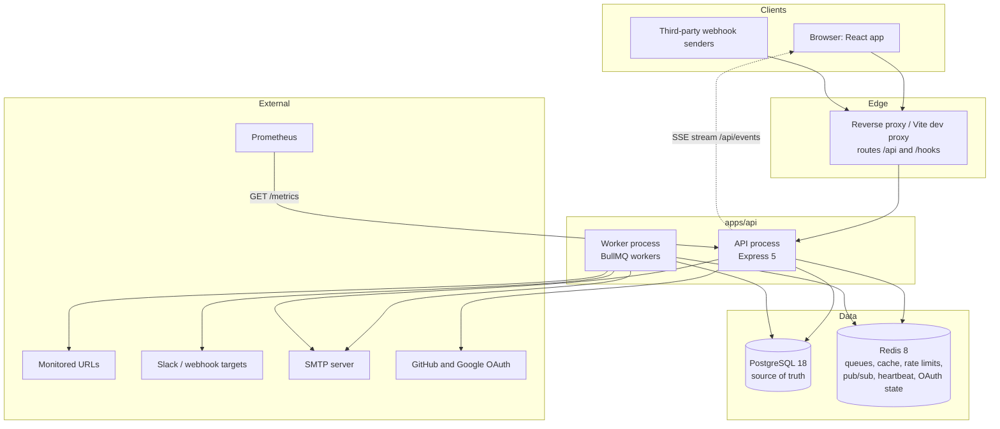

### Components

| Component  | Responsibility                                                                                     | Stateless? |
| ---------- | -------------------------------------------------------------------------------------------------- | ---------- |
| API        | Authentication, authorization, validation, CRUD, webhook ingest, enqueueing jobs, live update streams, metrics | Yes (open streams are per process) |
| Worker     | Dispatching due checks, running checks, silence detection, alert delivery, cleanup                 | Yes        |
| PostgreSQL | Users, sessions, monitors, check results, webhooks, events, incidents, invitations, alert channels | No         |
| Redis      | BullMQ queues and schedules, cache entries, rate-limit counters, OAuth state, change pub/sub, worker heartbeat, per-host check slots, job metrics | No |
| Contracts  | Shared schemas, endpoint list, permission matrix, incident and invitation rules                    | n/a        |

### Technology choices

| Need               | Choice                         | Reason                                                                     |
| ------------------ | ------------------------------ | -------------------------------------------------------------------------- |
| HTTP server        | Express 5                      | Widely known; forwards async errors to the error handler                    |
| Database           | PostgreSQL                     | Constraints, partial indexes, transactions, JSONB for webhook headers       |
| ORM                | Drizzle                        | SQL-shaped and typed; generates reviewable SQL migrations                   |
| Queue              | BullMQ on Redis                | Retries, backoff, delayed and repeating jobs, deduplication by job id       |
| Cache, rate limits | Redis                          | Atomic counters with expiry; shared by all API instances                     |
| Passwords          | Argon2id                       | Current recommendation; memory-hard                                         |
| Tokens             | `jose` (HS256 JWT)             | Standards-compliant, algorithm pinned on verify                             |
| Logging            | pino                           | Fast structured logs with redaction                                         |
| Live updates       | Server-Sent Events + Redis pub/sub | One-way server-to-browser notices over plain HTTP (section 7.13)        |
| Email              | nodemailer over SMTP           | Works with any provider; Mailpit locally                                    |
| Outbound HTTP      | undici + ipaddr.js             | Connect-time address validation and manual redirects                        |
| Metrics            | prom-client                    | Standard Prometheus exposition                                              |

### API surface

All routes are under `/api` except the public ingest URL.

| Area           | Endpoints                                                                                       |
| -------------- | ----------------------------------------------------------------------------------------------- |
| Auth           | `GET /auth/config`, `POST /auth/register` (first owner only), `/auth/login`, `/auth/refresh`, `/auth/logout`, `/auth/logout-all`, `/auth/password/forgot`, `/auth/password/reset`, `/auth/email/verify`, `/auth/oauth/:provider/authorize`, `/auth/oauth/:provider/callback` |
| Account        | `PATCH /me`, `POST /me/password`, `POST /me/email/verification`, `GET /me/connections`, `DELETE /me/connections/:provider` |
| Monitors       | `GET/POST /monitors`, `GET/PATCH/DELETE /monitors/:id`, `GET /monitors/:id/checks`               |
| Webhooks       | `GET/POST /webhooks`, `GET/PATCH/DELETE /webhooks/:id`, `GET /webhooks/:id/events`               |
| Alert channels | `GET/POST /alert-channels`, `GET/PATCH/DELETE /alert-channels/:id`, `POST /alert-channels/:id/test`, `GET /alert-channels/:id/deliveries`, `GET /alert-channels/:id/signing-secret`, `POST /alert-channels/:id/signing-secret/rotate` |
| Incidents      | `GET /incidents` (`status` may be `active`), `GET /incidents/:id`, `POST /incidents/:id/acknowledge`, `POST /incidents/:id/resolve` |
| Team           | `GET /members`, `GET/PATCH/DELETE /members/:id`, `GET/POST /invitations`, `GET/DELETE /invitations/:id`, `GET /invitations/preview/:token`, `POST /invitations/accept` |
| Live updates   | `GET /events` (Server-Sent Events stream)                                                        |
| Operations     | `GET /health`, `GET /health/live`, `GET /health/ready`, `GET /metrics` (outside `/api`, bearer token) |
| Other          | `GET /dashboard/summary`, `ANY /hooks/:slug` (outside `/api`)                                    |

Conventions: JSON bodies; lists take `page` and `pageSize` and return `{ items, page, pageSize, total }` newest first;
errors return `{ error: { code, message, fieldErrors } }`; `201` on create, `204` on success without a body, `202` for
webhook ingest.

---

## 6. Data model

```mermaid
erDiagram
  users ||--o{ sessions : "has"
  users ||--o{ linked_accounts : "signs in with"
  users ||--o{ password_reset_tokens : "requests"
  users ||--o{ email_verification_tokens : "verifies with"
  users ||--o{ invitations : "sends"
  monitors ||--o{ check_results : "produces"
  monitors ||--o{ monitor_alert_channels : ""
  alert_channels ||--o{ monitor_alert_channels : ""
  webhooks ||--o{ webhook_events : "receives"
  webhooks ||--o{ webhook_alert_channels : ""
  alert_channels ||--o{ webhook_alert_channels : ""
  monitors ||--o{ incidents : "source"
  webhooks ||--o{ incidents : "source"
  alert_channels ||--o{ alert_deliveries : "records"
  incidents ||--o{ alert_deliveries : "about"

  users {
    uuid id PK
    text name
    text email "unique on lower(email)"
    text password_hash "null for OAuth-only users"
    role role "one owner (partial unique index)"
    timestamptz email_verified_at
    timestamptz created_at
  }
  sessions {
    uuid id PK
    uuid user_id FK
    uuid family_id "all rotations of one login"
    text token_hash UK
    timestamptz expires_at
    timestamptz revoked_at
  }
  linked_accounts {
    uuid user_id PK
    oauth_provider provider PK
    text provider_account_id "unique with provider"
    text email
  }
  password_reset_tokens {
    uuid id PK
    uuid user_id FK
    text token_hash UK
    timestamptz expires_at
    timestamptz used_at
  }
  email_verification_tokens {
    uuid id PK
    uuid user_id FK
    text email "address being verified"
    text token_hash UK
    timestamptz expires_at
    timestamptz used_at
  }
  invitations {
    uuid id PK
    text email "one pending per email"
    role role
    invitation_status status
    uuid invited_by FK
    timestamptz expires_at
  }
  monitors {
    uuid id PK
    text name
    text url
    http_method method
    int interval_seconds
    int timeout_ms
    int expected_status_code
    bool is_paused
    int failure_threshold "1 to 10, default 2"
    int consecutive_failures
    monitor_status status
    timestamptz last_checked_at
    int last_response_time_ms
    real uptime_percent "precomputed, 24 h"
  }
  check_results {
    uuid id PK
    uuid monitor_id FK
    check_outcome outcome
    int status_code
    int response_time_ms
    text error_message
    timestamptz checked_at
  }
  webhooks {
    uuid id PK
    text name
    text slug UK "name prefix + 128 random bits"
    int expected_interval_seconds
    webhook_status status
    int event_count "lifetime total"
    timestamptz last_received_at
  }
  webhook_events {
    uuid id PK
    uuid webhook_id FK
    text method
    jsonb headers "credentials redacted"
    text body "raw, up to 256 KB"
    text content_type
    text source_ip
    timestamptz received_at
  }
  alert_channels {
    uuid id PK
    text name
    bool is_enabled
    alert_channel_type type
    text target
    text signing_secret "webhook channels"
  }
  alert_deliveries {
    uuid id PK
    uuid channel_id FK
    alert_event event
    uuid incident_id FK
    alert_delivery_status status "success, retrying, failed"
    int attempts
    text last_error
    timestamptz updated_at
  }
  monitor_alert_channels {
    uuid monitor_id PK
    uuid channel_id PK
  }
  webhook_alert_channels {
    uuid webhook_id PK
    uuid channel_id PK
  }
  incidents {
    uuid id PK
    incident_source_type source_type
    uuid source_id "one active per source"
    text source_name "denormalised for lists"
    incident_status status
    incident_severity severity "critical or warning"
    text cause
    timestamptz started_at
    timestamptz acknowledged_at
    text acknowledged_by_name "plus acknowledged_by_id"
    timestamptz resolved_at
    text resolved_by_name "plus resolved_by_id"
    incident_resolution_reason resolution_reason "recovered, monitor_paused, source_deleted"
    timestamptz source_deleted_at
  }
```

Design decisions:

- **Join tables** for monitor and webhook alert channels. Foreign keys guarantee channel ids exist, and
  `on delete cascade` removes links when a channel is deleted.
- **Polymorphic incident source** (`source_type`, `source_id`) instead of two nullable foreign keys. It matches the API
  shape. Deleting a source keeps its incidents: active ones are resolved with reason `source_deleted` and all are marked
  with `source_deleted_at`, so the UI shows the name without a broken link.
- **Denormalised `source_name`** on incidents, so the list does not join two tables. Renames update it.
- **Precomputed `uptime_percent`**, updated in the same transaction as each check.
- **Hashed tokens.** Refresh, reset and verification tokens are stored as SHA-256; invitation tokens are not stored at all
  (HMAC of the id).
- **Actor names are copied** onto incidents (`acknowledged_by_name`, `resolved_by_name`) so history stays readable after a
  member is removed.
- **Single owner** is enforced by a partial unique index on `users(role) WHERE role = 'owner'`, backing the advisory lock
  taken when the first account is created.

---

## 7. Low-level design

### 7.1 Code structure

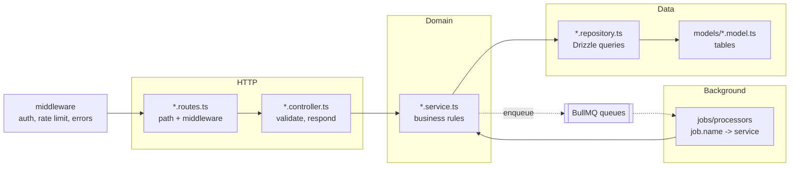

Rules: controllers never touch the database; services never touch `req`/`res`; only repositories import `db`; processors
only call services. Errors are thrown and formatted in one place.

### 7.2 Request pipeline

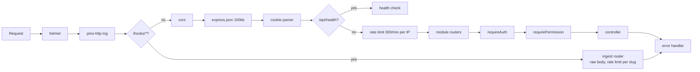

### 7.3 Sign in and refresh token rotation

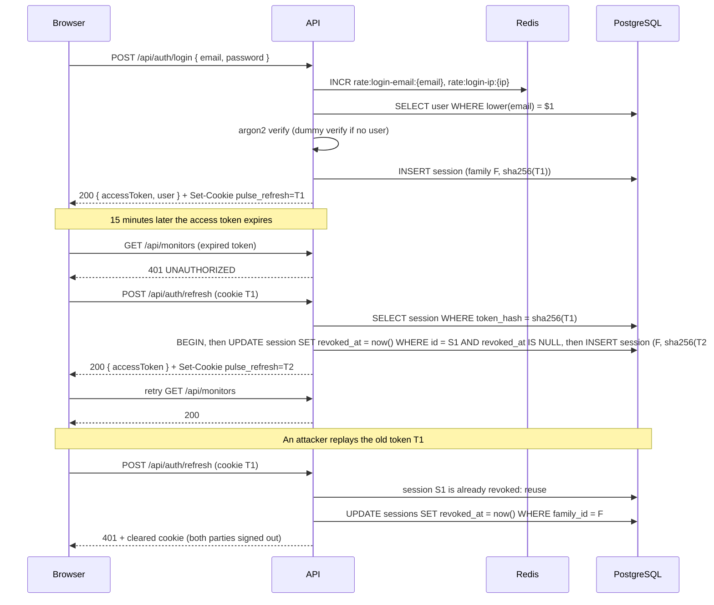

### 7.4 Authorization decision

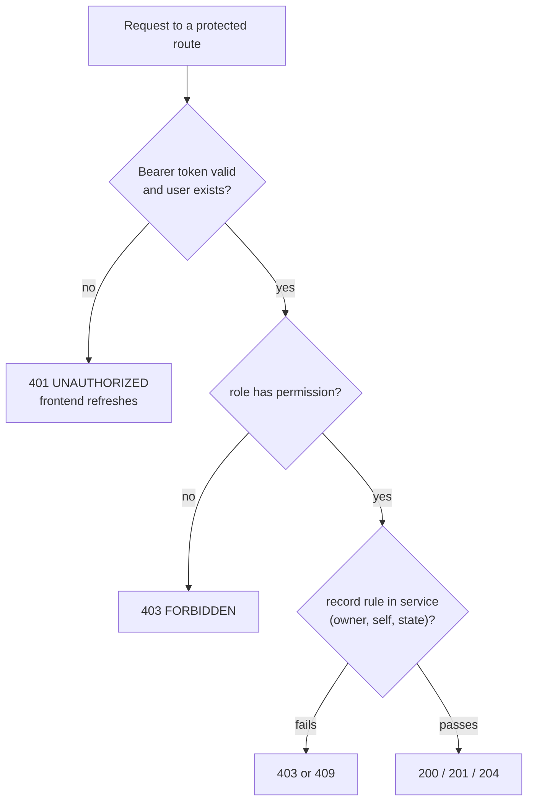

### 7.5 Monitoring pipeline

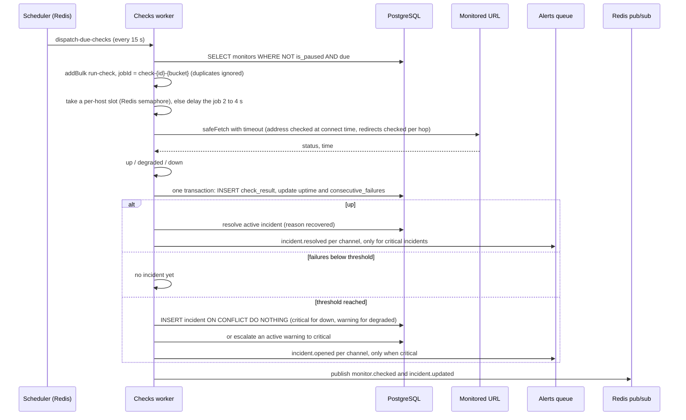

### 7.6 Incident lifecycle

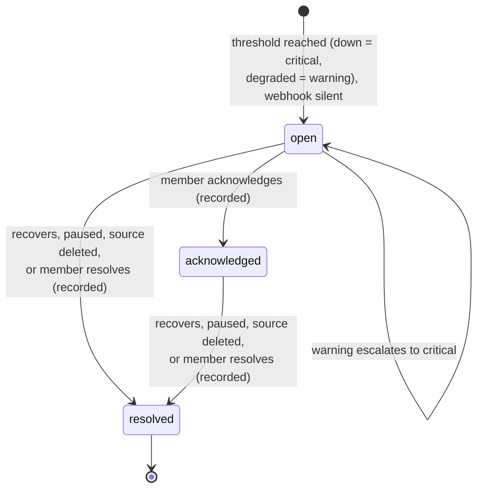

Warnings never page. Pausing a monitor or deleting a source resolves its active incident without an alert. Resolving an
incident whose source is still failing is allowed; a new incident opens after the next confirmed failure, and the UI
says so before you confirm.

Manual transitions are one statement: `UPDATE incidents SET status = $to, ... WHERE id = $1 AND status IN ($from)`. No row
back means the transition is not allowed (`409`) or the incident does not exist (`404`).

### 7.7 Webhook ingest and silence detection

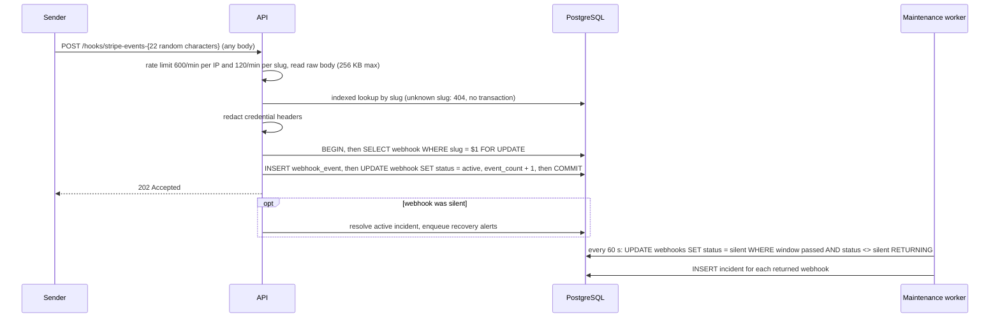

The body is read as raw text before any JSON parsing, so the stored payload is what was sent. Credential headers
(`Authorization`, cookies, API keys and anything named like a token, secret or password) are stored as `[redacted]`;
signature headers such as `stripe-signature` are kept. Every 50th event trims the endpoint to its cap, and the daily
cleanup applies retention.

### 7.8 Invitation flow

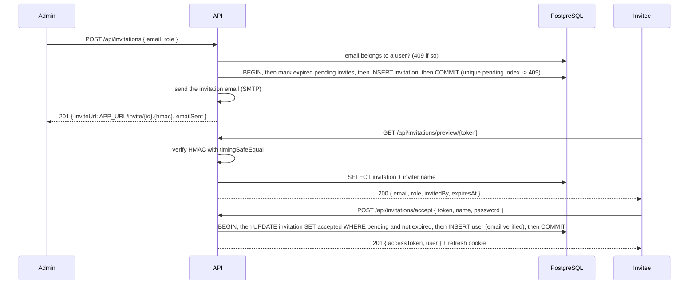

Invitations are the only way to join once the owner exists. If the email cannot be sent, the invitation is still created
and the response says `emailSent: false`, so the admin knows to share the link by hand.

### 7.9 Alert delivery

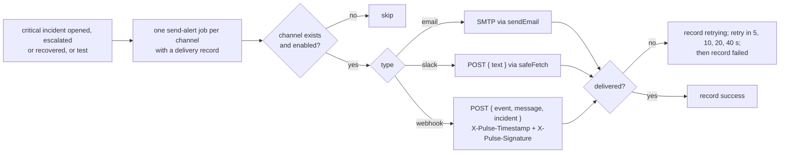

Each channel shows its last delivery (status, time, error) in the UI, and `GET /alert-channels/:id/deliveries` lists the
history (kept 30 days). A test alert runs the same delivery code synchronously, with a 5-second timeout and a limit of
10 per minute per user, and returns the result.

Webhook signatures: `X-Pulse-Timestamp: <unix seconds>` and
`X-Pulse-Signature: v1=<hex HMAC-SHA256(secret, "<timestamp>.<raw body>")>`. The secret can be copied and rotated by
users with `alert-channel:write`.

### 7.10 Caching and rate limiting

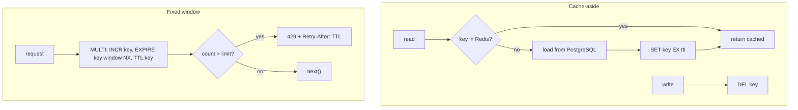

### 7.11 Concurrency and idempotency

| Situation                                   | What could go wrong            | Protection                                                     |
| ------------------------------------------- | ------------------------------ | -------------------------------------------------------------- |
| Two registrations with the same email       | Two accounts                   | `users_email_unique` index, mapped to 409                       |
| Two refresh calls with the same token       | Two valid sessions             | `UPDATE ... WHERE revoked_at IS NULL RETURNING` in a transaction |
| Dispatcher runs while a check is still running | Same check twice            | Deterministic BullMQ job id per interval bucket                 |
| Two failing checks for one monitor at once  | Two incidents, double alerts   | `incidents_one_active_per_source` partial unique index          |
| Two invites to the same email               | Two pending invites            | `invitations_one_pending_per_email` partial unique index        |
| Invite accepted twice                       | Two users                      | Conditional update on `pending`, inside the user-insert transaction |
| Concurrent events for a silent webhook      | Lost counter updates, double resolve | Row lock with `SELECT ... FOR UPDATE`, `event_count + 1` in SQL |
| Admin demotes a user mid-session            | Old role keeps working         | Role read per request (60 s cache, cleared on change)           |
| Two first sign-ups on an empty database     | Two owners                     | Advisory lock in the insert transaction, plus `users_single_owner` index |
| Many monitors created at once               | Limit exceeded                 | Advisory lock, count and insert in one transaction              |
| Many checks for one host                    | Target hammered, other checks starved | Redis semaphore per host with leases; busy jobs are delayed, not held |
| Check finishes after the monitor is paused  | Incident left open             | Counter update skipped when paused; incident insert locks the source row |
| Two resets with the same token              | Both succeed                   | Conditional update on `used_at IS NULL`; sibling tokens invalidated |

### 7.12 Failure handling

| Failure                         | Effect                                                     | Behaviour                                                         |
| ------------------------------- | ---------------------------------------------------------- | ----------------------------------------------------------------- |
| PostgreSQL down                 | API cannot serve data                                      | Requests fail with 500; `/api/health` returns 503                  |
| Redis down                      | No rate limits, cache, queues or OAuth state               | Requests that need Redis fail; `/api/health` returns 503           |
| Worker down                     | No checks or alerts                                        | Jobs wait in Redis and run when it returns; the heartbeat goes stale and `/api/health` returns 503 |
| Monitored URL hangs             | Check would block                                          | `AbortSignal.timeout` ends it; recorded as down                    |
| Target resolves to a private IP | Server reaches an internal network                         | Connection refused at connect time; recorded as "Blocked: private network address" |
| SMTP unavailable                | Email not sent                                             | Alerts retry and record failure; invitations return `emailSent: false`; resets log without the link |
| Live stream drops               | Browser misses changes                                     | Client reconnects with backoff and refetches every active query    |
| Slack or webhook target fails   | Alert not delivered                                        | Retried 5 times with backoff; other channels unaffected            |
| Process receives SIGTERM        | Deploy or scale-down                                       | Stops accepting work, finishes in-flight requests and jobs, closes connections |
| Unexpected exception            | A bug                                                      | Logged with stack; client gets a generic 500; uncaught errors log at fatal and exit so the process manager restarts |

### 7.13 Live updates

**The need.** Changes happen on the server (the worker finishes a check, an incident opens, a webhook arrives, a teammate
edits something), and every open tab should reflect them without a reload. Everything a user does already goes through
the REST API, so realtime traffic only flows one way: server to browser.

**Options considered.**

| Option | Verdict |
| ------ | ------- |
| Short polling | Simple, but latency equals the interval and load grows with tabs × screens × frequency, mostly answering "nothing changed". |
| Long polling | Better latency, but a new request per event and fiddly timeout handling: a worse version of SSE. |
| WebSockets | Two-way, which is not needed. Requires a protocol upgrade through every proxy, its own auth handshake, and hand-built heartbeats and reconnects. |
| Managed service (Pusher, Ably) | Adds a vendor, cost and a second auth system; worth it only at very large fan-out. |
| **Server-Sent Events** | **Chosen.** One-way by design, plain HTTP, so the existing auth, rate limits, logging and proxies apply unchanged. |

**Design.**

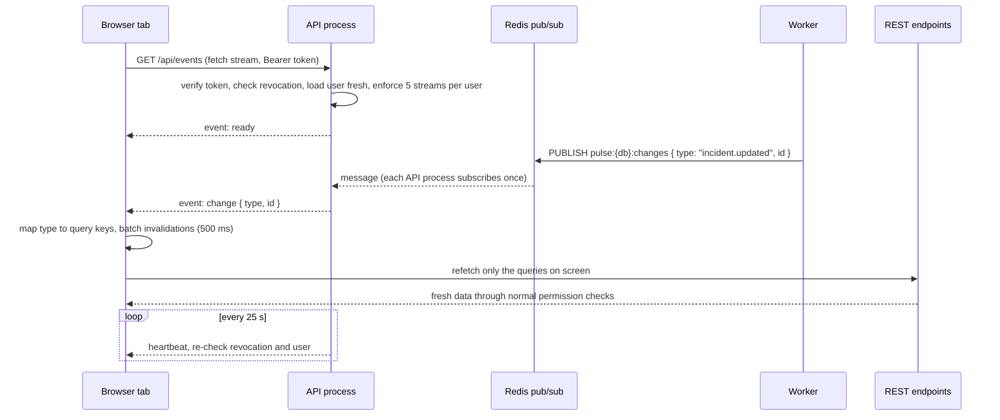

- **Notify, then refetch.** Events carry only a type and an id (`monitor.updated`, `monitor.deleted`, `monitor.checked`,
  `incident.updated`, `webhook.updated`, `webhook.deleted`, `webhook.event`, `alertChannel.updated`,
  `alertChannel.deleted`, `member.updated`, `member.deleted`, `invitation.updated`). Data always comes from the normal
  endpoints, so authorization stays in one place and payloads stay tiny.
- **Fan-out across processes.** The worker and every API process publish to one Redis channel; each API process holds a
  single subscriber and forwards to its own streams. No sticky sessions are needed.
- **Publishing never breaks a write.** `publishChange` is fire-and-forget and only logs failures.
- **Authentication.** The browser's `EventSource` cannot send an `Authorization` header, so the client reads the stream
  with `fetch` and the in-memory access token. A stream ends when its token expires or is revoked; the client refreshes the
  session and reconnects with exponential backoff and jitter, then refetches active queries to cover anything missed.
- **Visibility.** The header shows Live, Reconnecting or Paused (after 5 minutes hidden).

**Trade-offs.** Some proxies buffer streamed responses: the API sends `X-Accel-Buffering: no` and production proxies must
not buffer or compress `/api/events`. Browsers allow about six HTTP/1.1 connections per origin, so many tabs can exhaust
them; HTTP/2 in production removes that limit. The per-user stream cap is per API process. WebSockets would be worth
their cost only if Pulse gains genuinely two-way realtime features such as collaborative editing.

---

## 8. Scaling path

1. **More API instances** behind a load balancer. Nothing is stored in API memory: JWTs are self-contained, rate limits
   and cache live in Redis.
2. **More workers.** BullMQ hands each job to exactly one worker; deterministic job ids prevent duplicates across them.
3. **Database.** Add a read replica for list and dashboard queries. Partition `check_results` by month if retention
   grows, so dropping a month is instant.
4. **Fair scheduling.** At very high monitor counts, spread checks across the interval instead of on bucket boundaries.
5. **Live updates.** Each API instance holds its own streams and one Redis subscriber, so adding instances adds capacity
   linearly. At very large fan-out, move streams to a dedicated service or a managed realtime provider.
6. **Single workspace by design.** Pulse is one invite-only workspace with members. Hosting many independent companies
   would need a `workspace_id` on every table, index and query; that is not planned.

---

## 9. Trade-offs

| Decision                                  | Chosen because                                      | Cost                                                         |
| ----------------------------------------- | --------------------------------------------------- | ------------------------------------------------------------ |
| Short JWT + rotating refresh token        | Fast checks per request, revocable sessions         | More moving parts than a server-side session cookie          |
| Role loaded per request, not in the JWT   | Role changes apply immediately                      | One cached lookup per request                                |
| Database constraints decide conflicts     | Race-free and fewer queries                         | Constraint names must be mapped to friendly messages         |
| Polymorphic incident source               | Matches the API, keeps history simple               | No foreign key; deletes are handled in services              |
| Fixed-window rate limit                   | Simple and atomic                                   | Allows a burst at window edges; sliding window is smoother    |
| Precomputed uptime                        | Cheap reads                                         | Must be kept correct on every write                          |
| HMAC invitation tokens                    | No secret stored, link can be rebuilt               | Rotating `INVITE_SECRET` invalidates open invites            |
| Invite-only single workspace              | Matches the product (one team); closes public sign-up exposure | No self-service sign-up; owner bootstrap needs a one-time step |
| Failure threshold before incidents        | Fewer false pages from network blips                | Detection is delayed by (threshold - 1) intervals            |
| Warnings do not page                      | Slow is not down; less alert fatigue                | A slow-only problem is visible but silent                    |
| Server-Sent Events, notify then refetch   | Plain HTTP, permissions in one place                | A refetch per change; needs proxy buffering off              |
| Connect-time SSRF checks, always on       | Closes redirect and DNS rebinding bypasses          | Local development must opt in to private targets             |
| SMTP with any provider                    | No vendor lock-in; Mailpit locally                  | Production must supply SMTP credentials                      |
