# Pulse system design

A reference for how Pulse is designed, from what it must do down to how each important flow works. It goes in the usual
order: functional requirements, non-functional requirements, estimates, high-level design, then low-level design.

For how the code is organised and how to work in it, see [backend-guide.md](./backend-guide.md).

---

## 1. Problem

Small teams need to know when an API stops answering, or when a third party stops sending the webhooks they depend on,
before their users notice. Pulse checks endpoints on a schedule, records incoming webhooks, opens an incident when
something breaks, tells the team, and closes the incident when the problem goes away.

---

## 2. Functional requirements

### Accounts and access

- FR1. A person can register with name, email and password. The first account becomes the workspace owner.
- FR2. A user can sign in with email and password, or with GitHub or Google.
- FR3. A session survives page reloads for up to 7 days and can be ended on one device or on all devices.
- FR4. A user can reset a forgotten password through an emailed link.
- FR5. A user can edit their name and email, change their password, and connect or disconnect GitHub and Google.

### Team

- FR6. Owners and admins can invite people by email with a role (admin, member, viewer). The invitee joins through a
  link that expires after 7 days.
- FR7. Owners and admins can change a member's role or remove them. The owner can never be changed or removed, and no one
  can change their own access.
- FR8. What a user can do depends on their role (see the permission matrix in the backend guide).

### Monitoring

- FR9. Users can create HTTP monitors: URL, method, check interval (30 s to 1 day), timeout (1 to 30 s), expected status
  code, and alert channels.
- FR10. Each monitor is checked on its interval. Each check records outcome (up, degraded, down), status code, response
  time and error.
- FR11. Users can pause and resume monitors, and see check history, response time and 24-hour uptime.

### Webhooks

- FR12. Users can create webhook endpoints. Each gets a unique public ingest URL.
- FR13. Any request to an ingest URL is stored exactly as received (method, headers, body, content type, source IP).
- FR14. An endpoint can have a silence window. If no event arrives within it, the endpoint is marked silent.

### Incidents and alerts

- FR15. An incident opens when a monitor is down or degraded, or a webhook goes silent. At most one incident is active per
  source.
- FR16. An incident resolves automatically when its source recovers. Users can acknowledge and resolve incidents by hand.
- FR17. Users can configure alert channels (email, Slack, generic webhook) and send a test alert.
- FR18. When an incident opens or resolves, every enabled channel linked to the source is notified.

### Overview

- FR19. A dashboard shows monitors by status, webhooks by status, open incidents, average response time and uptime.

---

## 3. Non-functional requirements

| #     | Quality          | Requirement                                                                          | How Pulse meets it                                                              |
| ----- | ---------------- | ------------------------------------------------------------------------------------ | ------------------------------------------------------------------------------- |
| NFR1  | Latency          | API reads answer in under 200 ms at p95                                               | Indexed queries, no N+1, cached dashboard and user lookups                       |
| NFR2  | Isolation        | Slow checks never slow down user requests                                             | Checks and alerts run in a separate worker process via queues                   |
| NFR3  | Timeliness       | A down endpoint opens an incident within its interval plus 15 s                       | Dispatcher runs every 15 s; checks run with concurrency 20                       |
| NFR4  | Correctness      | No duplicate incidents or duplicate alerts, even with concurrent jobs                 | Partial unique index, deterministic job ids, conditional updates                 |
| NFR5  | Reliability      | Failed alert deliveries are retried; one broken channel does not block others         | One job per channel, 5 attempts with exponential backoff                         |
| NFR6  | Durability       | Schedules and queued work survive restarts                                            | Stored in Redis by BullMQ, not in process memory                                 |
| NFR7  | Security         | Passwords and tokens are safe even if the database leaks                              | Argon2id passwords, SHA-256 hashed refresh and reset tokens, HMAC invite tokens  |
| NFR8  | Security         | Stolen tokens are detected and sign-out takes effect at once                          | Refresh rotation with family revocation on reuse; access tokens issued before a sign-out-everywhere or password change are rejected |
| NFR9  | Security         | Brute force and abuse are limited                                                     | Redis rate limits per email, IP and webhook slug                                 |
| NFR10 | Security         | Every rule is enforced on the server                                                  | `requirePermission` on every route; record rules in services and SQL             |
| NFR11 | Security         | The server cannot be used to reach internal networks                                  | Outbound URL guard blocks private ranges in production                           |
| NFR12 | Consistency      | Frontend and backend agree on every shape                                             | Shared zod contracts used for validation on both sides                           |
| NFR13 | Operability      | Problems are visible and the service can be checked and restarted safely             | JSON logs with secrets redacted, health endpoint, graceful shutdown              |
| NFR14 | Storage          | Data does not grow without bound                                                      | 30-day check retention, session and token cleanup, trimmed job history          |
| NFR15 | Scalability      | API and worker can scale horizontally                                                 | Stateless API (JWT + shared Redis), workers coordinate through Redis             |

---

## 4. Back-of-the-envelope estimates

Assume a busy workspace: 1,000 monitors with an average interval of 60 s, and 50 webhook endpoints receiving 10 events a
minute each.

| Quantity              | Estimate                                         |
| --------------------- | ------------------------------------------------ |
| Checks per second     | 1,000 / 60 ≈ 17                                  |
| Check rows per day    | 17 × 86,400 ≈ 1.44 million                       |
| Check rows kept       | 30 days ≈ 43 million rows, a few GB with indexes |
| Webhook events / day  | 50 × 10 × 1,440 = 720,000                         |
| Worker concurrency    | 17 checks/s × up to 30 s timeout = up to ~500 in flight in the worst case; typical checks finish in under 1 s, so 20 concurrent slots per worker are enough and more workers can be added |
| Dashboard reads       | One poll per open tab; cached for 30 s, so the database sees at most 2 summary computations a minute |

These numbers are why check results have a retention policy and a `(monitor_id, checked_at desc)` index, and why uptime is
precomputed on each check instead of on each read.

---

## 5. High-level design

### Architecture

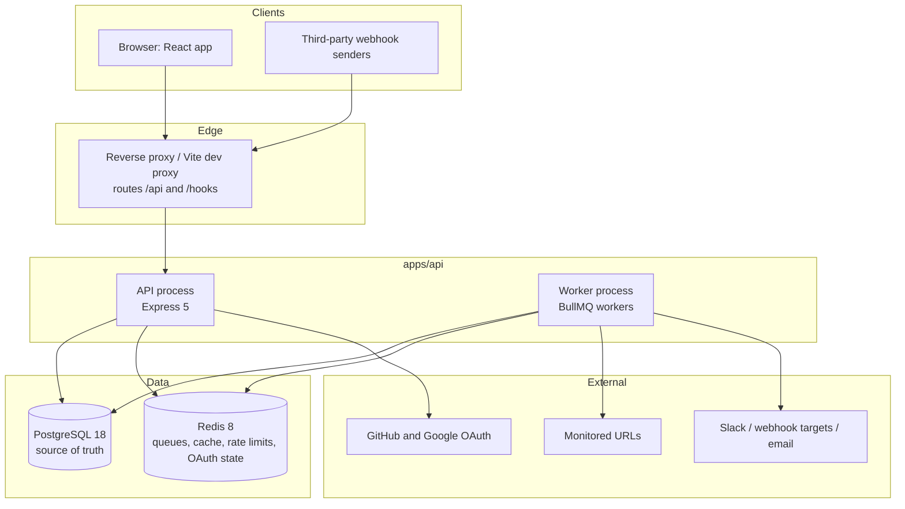

### Components

| Component  | Responsibility                                                                                     | Stateless? |
| ---------- | -------------------------------------------------------------------------------------------------- | ---------- |
| API        | Authentication, authorization, validation, CRUD, webhook ingest, enqueueing jobs                   | Yes        |
| Worker     | Dispatching due checks, running checks, silence detection, alert delivery, cleanup                 | Yes        |
| PostgreSQL | Users, sessions, monitors, check results, webhooks, events, incidents, invitations, alert channels | No         |
| Redis      | BullMQ queues and schedules, cache entries, rate-limit counters, OAuth state                       | No         |
| Contracts  | Shared schemas, endpoint list, permission matrix, incident and invitation rules                    | n/a        |

### Technology choices

| Need               | Choice                         | Reason                                                                     |
| ------------------ | ------------------------------ | -------------------------------------------------------------------------- |
| HTTP server        | Express 5                      | Widely known; forwards async errors to the error handler                    |
| Database           | PostgreSQL                     | Constraints, partial indexes, transactions, JSONB for webhook headers       |
| ORM                | Drizzle                        | SQL-shaped and typed; generates reviewable SQL migrations                   |
| Queue              | BullMQ on Redis                | Retries, backoff, delayed and repeating jobs, deduplication by job id       |
| Cache, rate limits | Redis                          | Atomic counters with expiry; shared by all API instances                     |
| Passwords          | Argon2id                       | Current recommendation; memory-hard                                         |
| Tokens             | `jose` (HS256 JWT)             | Standards-compliant, algorithm pinned on verify                             |
| Logging            | pino                           | Fast structured logs with redaction                                         |

### API surface

All routes are under `/api` except the public ingest URL.

| Area           | Endpoints                                                                                       |
| -------------- | ----------------------------------------------------------------------------------------------- |
| Auth           | `POST /auth/register`, `/auth/login`, `/auth/refresh`, `/auth/logout`, `/auth/logout-all`, `/auth/password/forgot`, `/auth/password/reset`, `/auth/oauth/:provider/authorize`, `/auth/oauth/:provider/callback` |
| Account        | `PATCH /me`, `POST /me/password`, `GET /me/connections`, `DELETE /me/connections/:provider`      |
| Monitors       | `GET/POST /monitors`, `GET/PATCH/DELETE /monitors/:id`, `GET /monitors/:id/checks`               |
| Webhooks       | `GET/POST /webhooks`, `GET/PATCH/DELETE /webhooks/:id`, `GET /webhooks/:id/events`               |
| Alert channels | `GET/POST /alert-channels`, `GET/PATCH/DELETE /alert-channels/:id`, `POST /alert-channels/:id/test` |
| Incidents      | `GET /incidents`, `GET /incidents/:id`, `POST /incidents/:id/acknowledge`, `POST /incidents/:id/resolve` |
| Team           | `GET /members`, `GET/PATCH/DELETE /members/:id`, `GET/POST /invitations`, `GET/DELETE /invitations/:id`, `GET /invitations/preview/:token`, `POST /invitations/accept` |
| Other          | `GET /dashboard/summary`, `GET /health`, `ANY /hooks/:slug` (outside `/api`)                     |

Conventions: JSON bodies; lists take `page` and `pageSize` and return `{ items, page, pageSize, total }` newest first;
errors return `{ error: { code, message, fieldErrors } }`; `201` on create, `204` on success without a body, `202` for
webhook ingest.

---

## 6. Data model

```mermaid
erDiagram
  users ||--o{ sessions : "has"
  users ||--o{ linked_accounts : "signs in with"
  users ||--o{ password_reset_tokens : "requests"
  users ||--o{ invitations : "sends"
  monitors ||--o{ check_results : "produces"
  monitors ||--o{ monitor_alert_channels : ""
  alert_channels ||--o{ monitor_alert_channels : ""
  webhooks ||--o{ webhook_events : "receives"
  webhooks ||--o{ webhook_alert_channels : ""
  alert_channels ||--o{ webhook_alert_channels : ""
  monitors ||--o{ incidents : "source"
  webhooks ||--o{ incidents : "source"

  users {
    uuid id PK
    text name
    text email "unique on lower(email)"
    text password_hash "null for OAuth-only users"
    role role
    timestamptz created_at
  }
  sessions {
    uuid id PK
    uuid user_id FK
    uuid family_id "all rotations of one login"
    text token_hash UK
    timestamptz expires_at
    timestamptz revoked_at
  }
  linked_accounts {
    uuid user_id PK
    oauth_provider provider PK
    text provider_account_id "unique with provider"
    text email
  }
  password_reset_tokens {
    uuid id PK
    uuid user_id FK
    text token_hash UK
    timestamptz expires_at
    timestamptz used_at
  }
  invitations {
    uuid id PK
    text email "one pending per email"
    role role
    invitation_status status
    uuid invited_by FK
    timestamptz expires_at
  }
  monitors {
    uuid id PK
    text name
    text url
    http_method method
    int interval_seconds
    int timeout_ms
    int expected_status_code
    bool is_paused
    monitor_status status
    timestamptz last_checked_at
    int last_response_time_ms
    real uptime_percent "precomputed, 24 h"
  }
  check_results {
    uuid id PK
    uuid monitor_id FK
    check_outcome outcome
    int status_code
    int response_time_ms
    text error_message
    timestamptz checked_at
  }
  webhooks {
    uuid id PK
    text name
    text slug UK
    int expected_interval_seconds
    webhook_status status
    int event_count
    timestamptz last_received_at
  }
  webhook_events {
    uuid id PK
    uuid webhook_id FK
    text method
    jsonb headers
    text body "raw, exactly as received"
    text content_type
    text source_ip
    timestamptz received_at
  }
  alert_channels {
    uuid id PK
    text name
    bool is_enabled
    alert_channel_type type
    text target
  }
  monitor_alert_channels {
    uuid monitor_id PK
    uuid channel_id PK
  }
  webhook_alert_channels {
    uuid webhook_id PK
    uuid channel_id PK
  }
  incidents {
    uuid id PK
    incident_source_type source_type
    uuid source_id "one active per source"
    text source_name "denormalised for lists"
    incident_status status
    text cause
    timestamptz started_at
    timestamptz acknowledged_at
    timestamptz resolved_at
  }
```

Design decisions:

- **Join tables** for monitor and webhook alert channels. Foreign keys guarantee channel ids exist, and
  `on delete cascade` removes links when a channel is deleted.
- **Polymorphic incident source** (`source_type`, `source_id`) instead of two nullable foreign keys. It matches the API
  shape. The services delete a source's incidents when the source is deleted.
- **Denormalised `source_name`** on incidents, so the list does not join two tables. Renames update it.
- **Precomputed `uptime_percent`**, updated in the same transaction as each check.
- **Hashed tokens.** Refresh and reset tokens are stored as SHA-256; invitation tokens are not stored at all (HMAC of the
  id).

---

## 7. Low-level design

### 7.1 Code structure

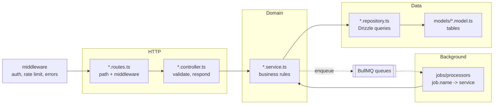

Rules: controllers never touch the database; services never touch `req`/`res`; only repositories import `db`; processors
only call services. Errors are thrown and formatted in one place.

### 7.2 Request pipeline

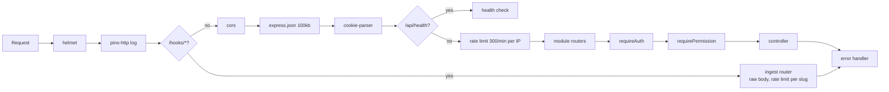

### 7.3 Sign in and refresh token rotation

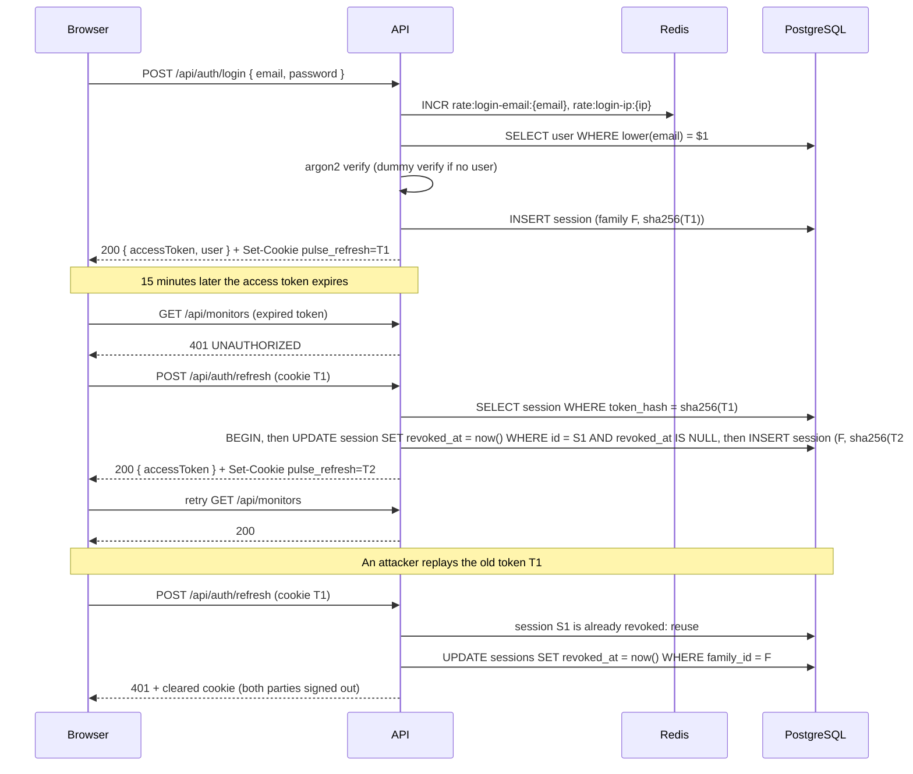

### 7.4 Authorization decision

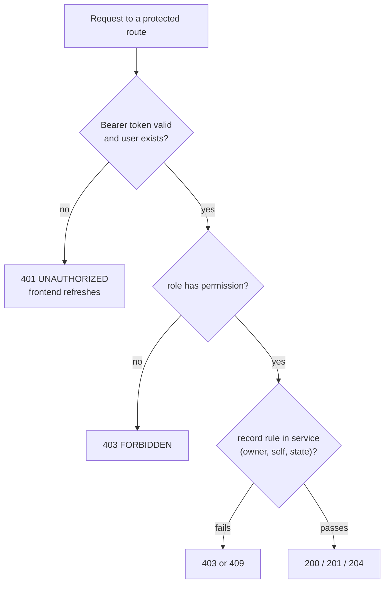

### 7.5 Monitoring pipeline

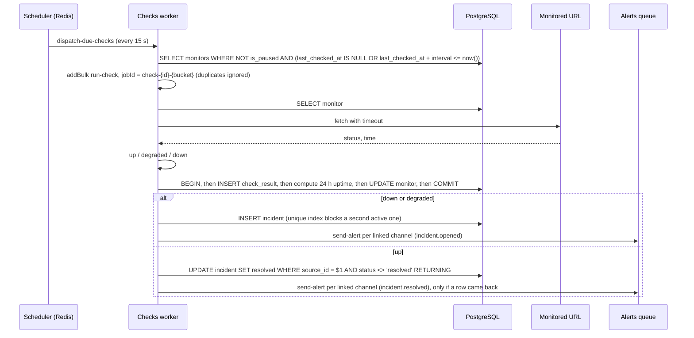

### 7.6 Incident lifecycle

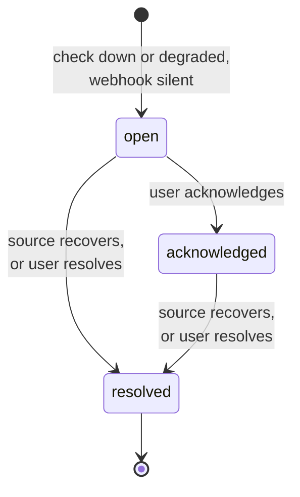

Manual transitions are one statement: `UPDATE incidents SET status = $to, ... WHERE id = $1 AND status IN ($from)`. No row
back means the transition is not allowed (`409`) or the incident does not exist (`404`).

### 7.7 Webhook ingest and silence detection

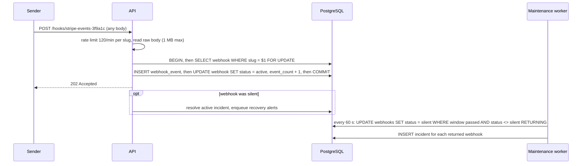

The body is read as raw text before any JSON parsing, so the stored payload is byte-for-byte what was sent. That matters
for inspecting and for verifying sender signatures.

### 7.8 Invitation flow

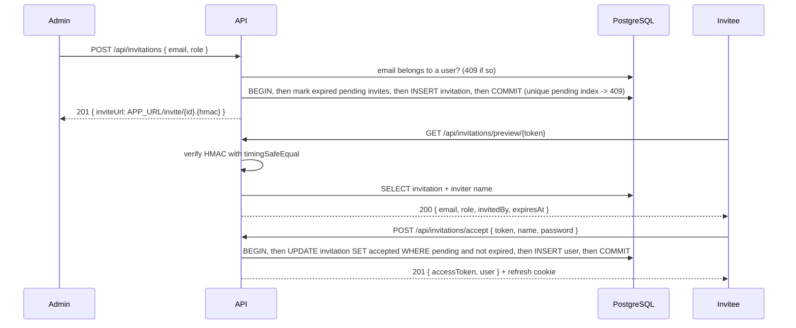

### 7.9 Alert delivery

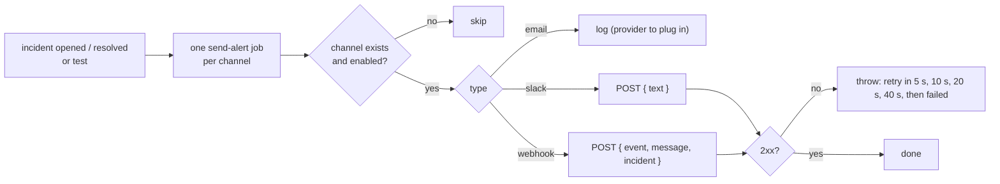

### 7.10 Caching and rate limiting

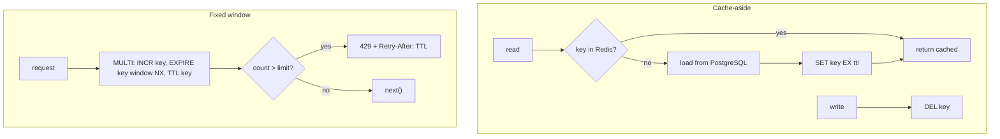

### 7.11 Concurrency and idempotency

| Situation                                   | What could go wrong            | Protection                                                     |
| ------------------------------------------- | ------------------------------ | -------------------------------------------------------------- |
| Two registrations with the same email       | Two accounts                   | `users_email_unique` index, mapped to 409                       |
| Two refresh calls with the same token       | Two valid sessions             | `UPDATE ... WHERE revoked_at IS NULL RETURNING` in a transaction |
| Dispatcher runs while a check is still running | Same check twice            | Deterministic BullMQ job id per interval bucket                 |
| Two failing checks for one monitor at once  | Two incidents, double alerts   | `incidents_one_active_per_source` partial unique index          |
| Two invites to the same email               | Two pending invites            | `invitations_one_pending_per_email` partial unique index        |
| Invite accepted twice                       | Two users                      | Conditional update on `pending`, inside the user-insert transaction |
| Concurrent events for a silent webhook      | Lost counter updates, double resolve | Row lock with `SELECT ... FOR UPDATE`, `event_count + 1` in SQL |
| Admin demotes a user mid-session            | Old role keeps working         | Role read per request (60 s cache, cleared on change)           |

### 7.12 Failure handling

| Failure                         | Effect                                                     | Behaviour                                                         |
| ------------------------------- | ---------------------------------------------------------- | ----------------------------------------------------------------- |
| PostgreSQL down                 | API cannot serve data                                      | Requests fail with 500; `/api/health` returns 503                  |
| Redis down                      | No rate limits, cache, queues or OAuth state               | Requests that need Redis fail; `/api/health` returns 503           |
| Worker down                     | No checks or alerts                                        | Jobs wait in Redis and run when it returns; schedules are kept     |
| Monitored URL hangs             | Check would block                                          | `AbortSignal.timeout` ends it; recorded as down                    |
| Slack or webhook target fails   | Alert not delivered                                        | Retried 5 times with backoff; other channels unaffected            |
| Process receives SIGTERM        | Deploy or scale-down                                       | Stops accepting work, finishes in-flight requests and jobs, closes connections |
| Unexpected exception            | A bug                                                      | Logged with stack; client gets a generic 500                       |

---

## 8. Scaling path

1. **More API instances** behind a load balancer. Nothing is stored in API memory: JWTs are self-contained, rate limits
   and cache live in Redis.
2. **More workers.** BullMQ hands each job to exactly one worker; deterministic job ids prevent duplicates across them.
3. **Database.** Add a read replica for list and dashboard queries. Partition `check_results` by month if retention
   grows, so dropping a month is instant.
4. **Fair scheduling.** At very high monitor counts, spread checks across the interval instead of on bucket boundaries.
5. **Multi-tenant.** Today there is one workspace. Supporting many means a `workspace_id` on every table, in every index,
   and in every query.

---

## 9. Trade-offs

| Decision                                  | Chosen because                                      | Cost                                                         |
| ----------------------------------------- | --------------------------------------------------- | ------------------------------------------------------------ |
| Short JWT + rotating refresh token        | Fast checks per request, revocable sessions         | More moving parts than a server-side session cookie          |
| Role loaded per request, not in the JWT   | Role changes apply immediately                      | One cached lookup per request                                |
| Database constraints decide conflicts     | Race-free and fewer queries                         | Constraint names must be mapped to friendly messages         |
| Polymorphic incident source               | Matches the API, keeps history simple               | No foreign key; deletes are handled in services              |
| Fixed-window rate limit                   | Simple and atomic                                   | Allows a burst at window edges; sliding window is smoother    |
| Precomputed uptime                        | Cheap reads                                         | Must be kept correct on every write                          |
| HMAC invitation tokens                    | No secret stored, link can be rebuilt               | Rotating `INVITE_SECRET` invalidates open invites            |
| Email alerts logged, not sent             | No provider dependency yet                          | Needs a provider before real use                             |
